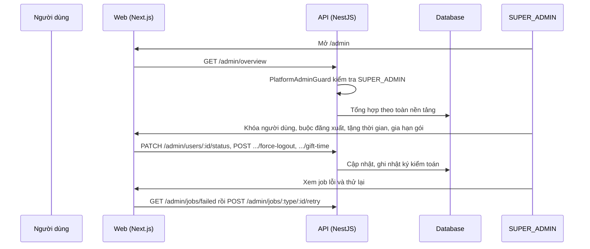

# F51: Admin nền tảng (người dùng, tổ chức, gói, thanh toán, credit, audit, jobs, tích hợp)

- **Nhóm:** L. Quản trị nền tảng
- **Mức ưu tiên:** P0
- **Route giao diện:** `/admin/*`
- **API chính:**
  - `GET /admin/overview`
  - `GET /admin/organizations`
  - `PATCH /admin/organizations/:id/status`
  - `GET /admin/users`
  - `PATCH /admin/users/:id/status`
  - `POST /admin/users/:id/force-logout`
  - `POST /admin/users/:id/gift-time`
  - `POST /admin/subscriptions/:id/extend`
  - `GET /admin/jobs/failed`
  - `POST /admin/jobs/:type/:id/retry`
  - `GET /admin/audit-logs`
  - `GET /admin/integrations/health`
  - `GET /admin/billing/orders`

## Điều kiện trước khi test

- Tài khoản SUPER_ADMIN
- Tổ chức và người dùng thử

## Sơ đồ sequence

## Các bước test

| # | Bước thực hiện | Kết quả mong đợi | Test tự động |
|---|---|---|---|
| 1 | Phân quyền: người thường không vào được /admin | Bị chặn | `test-platform-admin-rbac.ts` |
| 2 | Quản lý người dùng | Khóa, buộc đăng xuất đúng | `test-admin-user-mgmt.ts` |
| 3 | Vận hành: tổ chức, gói, jobs | Đúng thao tác | `test-admin-ops.ts` |
| 4 | Tặng credit | Cộng đúng và có nhật ký | `test-admin-gift-credit.ts` |
| 5 | Gia hạn gói và tặng thời gian | Ngày hết hạn đúng | Thủ công |
| 6 | Xem nhật ký kiểm toán | Đủ thao tác admin | Thủ công |
| 7 | Sức khỏe tích hợp | Hiển thị đúng trạng thái | Thủ công |
| 8 | Hardening giai đoạn 1 | Không phát sinh lỗ hổng cũ | `test-phase1-hardening.ts` |

## Trường hợp biên và lỗi cần thử

- Admin tự khóa mình
- Thao tác trên tổ chức khác không để lại dấu vết (phải có audit)

## Ghi chú

- Cột "Thủ công" nghĩa là chưa thấy test tự động tương ứng. Cần kiểm tra bằng tay hoặc viết test mới.
- Việc ghép test với bước dựa trên tên file, chưa mở đọc từng test. Chưa chạy lại để lấy baseline.
- Test có hậu tố `-live` hoặc `-e2e` gọi dịch vụ ngoài, chỉ chạy khi chủ động.
- Cách chạy và ma trận: `docs/test case/REGRESSION_MATRIX.md`.
