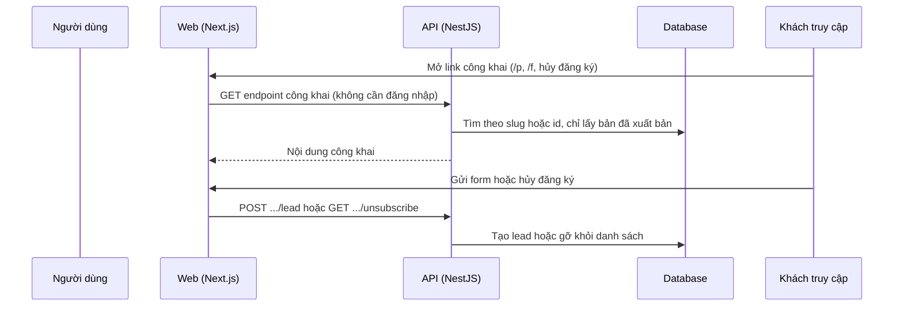

# F52: Trang công khai (landing page, form funnel, hủy đăng ký, callback)

- **Nhóm:** M. Trang công khai
- **Mức ưu tiên:** P0
- **Route giao diện:** `/p/[slug], /f/[id], /email-unsubscribe, /facebook, /privacy, /terms`
- **API chính:**
  - `GET /landing-pages/public/:slug`
  - `GET /funnel-builder/public/:id/form`
  - `POST /funnel-builder/public/:id/lead`
  - `GET /email-marketing/public/unsubscribe`
  - `GET /auto-post/facebook/oauth/callback`

## Điều kiện trước khi test

- Một landing page và một funnel đã xuất bản

## Sơ đồ sequence

## Các bước test

| # | Bước thực hiện | Kết quả mong đợi | Test tự động |
|---|---|---|---|
| 1 | Landing page /p/:slug | Xem LP06 và LP07 | Thủ công |
| 2 | Form funnel /f/:id tạo lead | Lead đúng tổ chức | `test-funnel-form-capture.ts` |
| 3 | Hủy đăng ký email | Người nhận bị gỡ, hiện trang xác nhận | Thủ công |
| 4 | Callback Facebook | Xử lý đúng mã, từ chối khi sai | `test-auto-post-meta-callbacks.ts` |
| 5 | Trang điều khoản và riêng tư | Hiển thị, không cần đăng nhập | Thủ công |
| 6 | Endpoint công khai không lộ dữ liệu nội bộ | Chỉ trả nội dung công khai | `test-p0-security.ts` |

## Trường hợp biên và lỗi cần thử

- Slug hoặc id không tồn tại
- Trang chưa xuất bản
- Gửi form hàng loạt (chống spam)

## Ghi chú

- Cột "Thủ công" nghĩa là chưa thấy test tự động tương ứng. Cần kiểm tra bằng tay hoặc viết test mới.
- Việc ghép test với bước dựa trên tên file, chưa mở đọc từng test. Chưa chạy lại để lấy baseline.
- Test có hậu tố `-live` hoặc `-e2e` gọi dịch vụ ngoài, chỉ chạy khi chủ động.
- Cách chạy và ma trận: `docs/test case/REGRESSION_MATRIX.md`.
