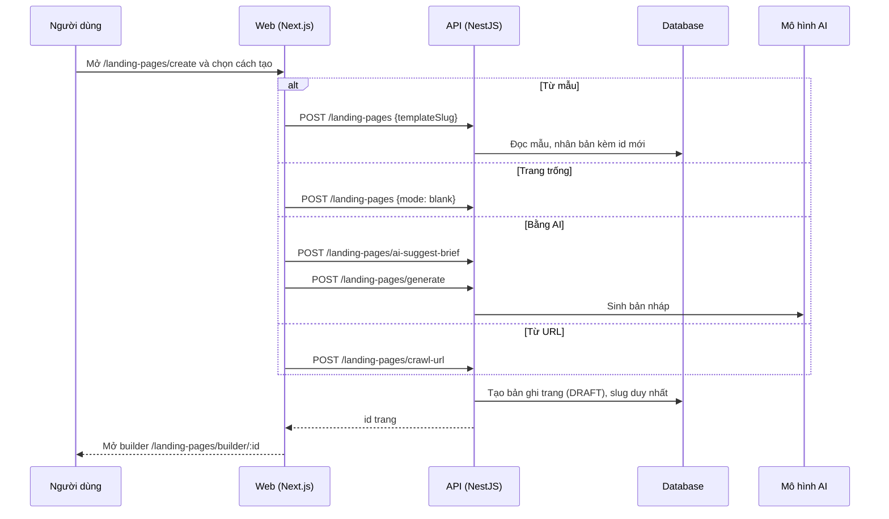

# LP01: Tạo landing page mới (từ mẫu, trang trống, AI, URL)

- **Nhóm:** D. Landing Page
- **Mức ưu tiên:** P1
- **Route giao diện:** `/landing-pages/create`
- **API chính:**
  - `POST /landing-pages`
  - `POST /landing-pages/generate`
  - `POST /landing-pages/ai-suggest-brief`
  - `POST /landing-pages/crawl-url`
  - `GET /landing-pages/templates`

## Điều kiện trước khi test

- Đã đăng nhập, đủ quyền lead.write
- Còn credit nếu dùng AI

## Sơ đồ sequence

## Các bước test

| # | Bước thực hiện | Kết quả mong đợi | Test tự động |
|---|---|---|---|
| 1 | Tạo trang trống | Mở builder với trang trống, không lỗi 400 | `test-landing-page-blank-create.cjs` |
| 2 | Tạo từ mẫu | Trang mới là bản sao đúng nội dung mẫu | `test-landing-page-create-template-picker.cjs` |
| 3 | Tạo bằng AI trước | Có bản nháp đúng ngành | `test-landing-page-create-ai-first.cjs` |
| 4 | Gợi ý brief bằng AI | Gợi ý hợp lý, điền được vào form | `test-landing-page-ai-brief-suggest.ts` |
| 5 | Sinh trang bằng AI | Trang hợp lệ, qua kiểm tra cấu trúc | `test-landing-page-ai-generation.ts` |
| 6 | Điền form tạo rồi tải lại trang | Giữ nội dung đã nhập | `test-landing-page-create-persistence-browser.ts` |
| 7 | Kiểm tra nhãn danh mục tiếng Việt | Đúng nhãn | `qa-landing-page-category-labels-browser.cjs` |
| 8 | Bấm tạo hai lần liên tiếp (nhấp đúp) | Chỉ tạo một trang (idempotency) | Thủ công |

## Trường hợp biên và lỗi cần thử

- Hết credit khi tạo bằng AI
- Slug trùng trong cùng tổ chức
- Chọn vừa mẫu vừa trang trống (API phải từ chối)

## Ghi chú

- Cột "Thủ công" nghĩa là chưa thấy test tự động tương ứng. Cần kiểm tra bằng tay hoặc viết test mới.
- Việc ghép test với bước dựa trên tên file, chưa mở đọc từng test. Chưa chạy lại để lấy baseline.
- Test có hậu tố `-live` hoặc `-e2e` gọi dịch vụ ngoài, chỉ chạy khi chủ động.
- Cách chạy và ma trận: `docs/test case/REGRESSION_MATRIX.md`.
