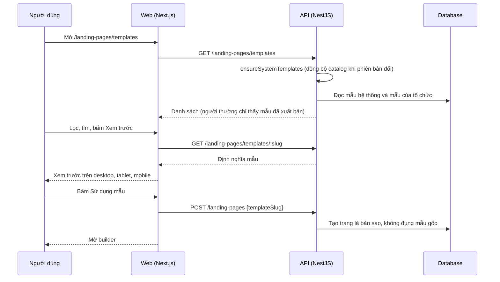

# LP02: Thư viện Templates (xem, lọc, xem trước, dùng mẫu)

- **Nhóm:** D. Landing Page
- **Mức ưu tiên:** P1
- **Route giao diện:** `/landing-pages/templates`
- **API chính:**
  - `GET /landing-pages/templates`
  - `GET /landing-pages/templates/:idOrSlug`
  - `POST /landing-pages`

## Điều kiện trước khi test

- Catalog 200 mẫu hệ thống đã đồng bộ vào database

## Sơ đồ sequence

## Các bước test

| # | Bước thực hiện | Kết quả mong đợi | Test tự động |
|---|---|---|---|
| 1 | Kiểm tra catalog 200 mẫu, slug không trùng, cấu trúc hợp lệ | Đạt | `validate-landing-page-template-catalog.cjs` |
| 2 | Lọc theo ngành, kiểu và tìm kiếm | Kết quả đúng | `test-landing-page-template-ui.cjs` |
| 3 | Xem trước mẫu ở ba khung hình | Đúng nội dung, không tràn ngang | `qa-landing-page-real-catalog.cjs` |
| 4 | Mỗi mẫu khác nhau về cấu trúc và kiểu trình bày | Không trùng lặp giữa các biến thể | `test-landing-page-template-differentiation.cjs` |
| 5 | Responsive một mẫu trong mỗi ngành | Không vỡ bố cục | `qa-landing-page-catalog-responsive.cjs` |
| 6 | Mẫu pilot Agency Portfolio không bị CSS chung ảnh hưởng | Giữ nguyên giao diện | `qa-agency-portfolio-isolation.cjs` |
| 7 | Dùng mẫu rồi sửa trang | Mẫu gốc và trang khách cũ không đổi | Thủ công |
| 8 | Tài khoản thường không thấy mẫu nháp, SUPER_ADMIN thấy | Đúng phạm vi hiển thị | Thủ công |
| 9 | Chạy audit 200 mẫu × 3 khung hình (script ngoài repo) | Không tràn ngang, đủ form, không có câu thiết kế rò rỉ | Thủ công |

## Trường hợp biên và lỗi cần thử

- Mẫu có ảnh không tải được
- Mẫu của tổ chức trùng slug với mẫu hệ thống
- Đổi phiên bản catalog khi có mẫu đã sửa tay

## Ghi chú

- Cột "Thủ công" nghĩa là chưa thấy test tự động tương ứng. Cần kiểm tra bằng tay hoặc viết test mới.
- Việc ghép test với bước dựa trên tên file, chưa mở đọc từng test. Chưa chạy lại để lấy baseline.
- Test có hậu tố `-live` hoặc `-e2e` gọi dịch vụ ngoài, chỉ chạy khi chủ động.
- Cách chạy và ma trận: `docs/test case/REGRESSION_MATRIX.md`.
