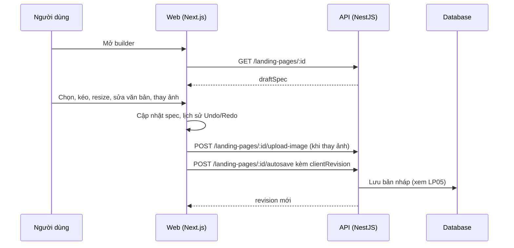

# LP03: Builder: chỉnh sửa nội dung và phần tử

- **Nhóm:** D. Landing Page
- **Mức ưu tiên:** P1
- **Route giao diện:** `/landing-pages/builder/[id]`
- **API chính:**
  - `GET /landing-pages/:id`
  - `POST /landing-pages/:id/autosave`
  - `POST /landing-pages/:id/upload-image`
  - `GET /landing-pages/:id/media`

## Điều kiện trước khi test

- Một trang nháp có nhiều loại phần tử (tiêu đề, văn bản, ảnh, nút, form)

## Sơ đồ sequence

## Các bước test

| # | Bước thực hiện | Kết quả mong đợi | Test tự động |
|---|---|---|---|
| 1 | Chọn element, menu chuột phải, toolbar | Toolbar và menu đúng vị trí, đúng nút | `qa-landing-page-element-toolbar-browser.cjs` |
| 2 | Kéo thả, resize, xoay element | Kích thước và vị trí đúng | `qa-landing-page-pointer-resize-browser.cjs` |
| 3 | Thả element vào hàng, cột | Đặt đúng chỗ, đúng chỉ báo thả | `qa-landing-page-drop-layout-browser.cjs` |
| 4 | Chọn nhóm, di chuyển nhóm, thả chuột | Khung chọn không kẹt, chuột không bị "dính" | `qa-landing-page-canvas-groups-browser.cjs` |
| 5 | Sửa văn bản: toolbar, hộp chữ, căn giữa | Định dạng áp đúng | `test-landing-page-text-toolbar.cjs` |
| 6 | Thay ảnh, icon, đồ họa từ thư viện | Hiển thị đúng, lưu được | `test-landing-page-media-modal.cjs` |
| 7 | Ẩn và khóa element | Trạng thái giữ khi tải lại | `test-landing-page-element-visibility-lock.cjs` |
| 8 | Không để element chồng lấn | Cảnh báo hoặc ngăn chồng lấn | `qa-landing-page-no-overlap-browser.cjs` |
| 9 | Kéo phần tử Lead Form | Di chuyển được tự do, không còn toolbar thừa trên đầu | Thủ công |
| 10 | Gõ phím Space khi đang sửa chữ | Không bị chặn hoặc cuộn trang | `test-landing-page-space-input.cjs` |

## Trường hợp biên và lỗi cần thử

- Kéo ra ngoài khung canvas
- Thả chuột ngoài cửa sổ trình duyệt (mất pointerup)
- Resize sau khi xoay

## Ghi chú

- Cột "Thủ công" nghĩa là chưa thấy test tự động tương ứng. Cần kiểm tra bằng tay hoặc viết test mới.
- Việc ghép test với bước dựa trên tên file, chưa mở đọc từng test. Chưa chạy lại để lấy baseline.
- Test có hậu tố `-live` hoặc `-e2e` gọi dịch vụ ngoài, chỉ chạy khi chủ động.
- Cách chạy và ma trận: `docs/test case/REGRESSION_MATRIX.md`.
