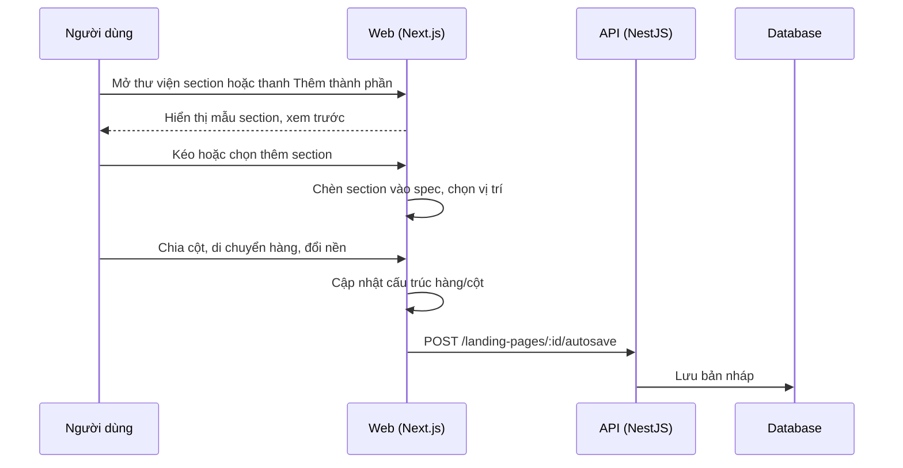

# LP04: Builder: section, hàng/cột, thư viện section, thêm thành phần

- **Nhóm:** D. Landing Page
- **Mức ưu tiên:** P1
- **Route giao diện:** `/landing-pages/builder/[id]`
- **API chính:**
  - `POST /landing-pages/:id/autosave`

## Điều kiện trước khi test

- Trang nháp có nhiều section

## Sơ đồ sequence

## Các bước test

| # | Bước thực hiện | Kết quả mong đợi | Test tự động |
|---|---|---|---|
| 1 | Thêm, di chuyển hàng và cột trong section | Cấu trúc đúng, giữ nội dung | `qa-landing-page-section-rows-browser.cjs` |
| 2 | Chia cột và thả vào cột | Đúng tỷ lệ cột | `test-landing-page-column-split.cjs` |
| 3 | Cài đặt section: nền, khoảng cách, tràn nội dung | Section tự giãn đủ nội dung, không cắt | `test-landing-page-section-content-overflow.cjs` |
| 4 | Thư viện section: xem trước, chất lượng, đồng bộ | Khớp với trang thật | `test-landing-page-section-library-parity.cjs` |
| 5 | Thêm thành phần bằng kéo thả và lưới | Thêm đúng chỗ | `test-landing-page-add-components-dnd.cjs` |
| 6 | Inspector: các chế độ và tab thiết kế | Hiển thị theo ngữ cảnh | `test-landing-page-inspector-modes.cjs` |
| 7 | Chuyển khung desktop, tablet, mobile | Bố cục responsive đúng | `test-landing-page-device-frame.cjs` |
| 8 | Xem trước toàn màn hình | Giống bản công khai | `test-landing-page-builder-preview-public-parity.cjs` |
| 9 | Đổi theme | Màu và font đổi đúng | `test-landing-page-theme-switcher.cjs` |

## Trường hợp biên và lỗi cần thử

- Section rất cao hoặc nhiều phần tử
- Xóa cột đang có nội dung
- Thêm section khi đang ở chế độ vị trí tự do

## Ghi chú

- Cột "Thủ công" nghĩa là chưa thấy test tự động tương ứng. Cần kiểm tra bằng tay hoặc viết test mới.
- Việc ghép test với bước dựa trên tên file, chưa mở đọc từng test. Chưa chạy lại để lấy baseline.
- Test có hậu tố `-live` hoặc `-e2e` gọi dịch vụ ngoài, chỉ chạy khi chủ động.
- Cách chạy và ma trận: `docs/test case/REGRESSION_MATRIX.md`.
