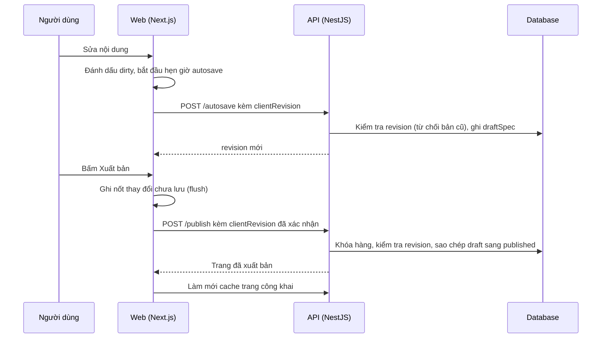

# LP05: Lưu, autosave, lịch sử, khôi phục, xuất bản

- **Nhóm:** D. Landing Page
- **Mức ưu tiên:** P0
- **Route giao diện:** `/landing-pages/builder/[id]`
- **API chính:**
  - `POST /landing-pages/:id/autosave`
  - `POST /landing-pages/:id/publish`
  - `POST /landing-pages/:id/unpublish`
  - `GET /landing-pages/:id/versions`
  - `POST /landing-pages/:id/versions/:version/restore`
  - `POST /landing-pages/:id/recover-draft`

## Điều kiện trước khi test

- Một trang nháp
- Có thể giả lập mất mạng và mở hai tab

## Sơ đồ sequence

## Các bước test

| # | Bước thực hiện | Kết quả mong đợi | Test tự động |
|---|---|---|---|
| 1 | Autosave không kẹt khi đang lưu | Lưu xong thì không còn trạng thái dirty | `test-landing-page-autosave-stuck.cjs` |
| 2 | Hai tab cùng sửa (xung đột) | Bản cũ bị từ chối, không tăng revision, báo tải bản mới | `test-landing-page-autosave-identity.cjs` |
| 3 | Xuất bản khi còn thay đổi chưa lưu | Lưu hết rồi mới xuất bản | `test-landing-page-publish-flush.cjs` |
| 4 | Xuất bản với revision cũ | Bị từ chối STALE_REVISION | `test-landing-page-revision.ts` |
| 5 | Undo, Redo, sửa trực tiếp | Lịch sử đúng thứ tự | `test-landing-page-history-live-edit.cjs` |
| 6 | Khôi phục phiên bản cũ | Nội dung đúng, revision hợp lệ | `test-landing-page-version-restore-revision.cjs` |
| 7 | Mất kết nối rồi mở lại | Khôi phục được bản nháp cục bộ | `test-landing-page-draft-recovery.ts` |
| 8 | Tải trang builder sau khi deploy bản mới | Không lỗi tải chunk | `test-landing-page-next-chunk-reload.cjs` |
| 9 | Mở route builder thật | Không lỗi client | `qa-landing-page-client-route-browser.cjs` |
| 10 | Hủy xuất bản | Trang công khai ngừng hiển thị | Thủ công |

## Trường hợp biên và lỗi cần thử

- Lưu đồng thời hai yêu cầu
- Trang đã lưu trữ không cho sửa
- Xuất bản trang tạm sửa mẫu phải bị chặn (xem LP09)

## Ghi chú

- Cột "Thủ công" nghĩa là chưa thấy test tự động tương ứng. Cần kiểm tra bằng tay hoặc viết test mới.
- Việc ghép test với bước dựa trên tên file, chưa mở đọc từng test. Chưa chạy lại để lấy baseline.
- Test có hậu tố `-live` hoặc `-e2e` gọi dịch vụ ngoài, chỉ chạy khi chủ động.
- Cách chạy và ma trận: `docs/test case/REGRESSION_MATRIX.md`.
