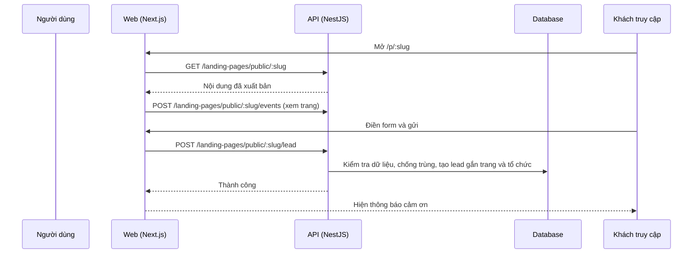

# LP06: Form thu lead trên trang công khai

- **Nhóm:** D. Landing Page
- **Mức ưu tiên:** P0
- **Route giao diện:** `/p/[slug]`
- **API chính:**
  - `POST /landing-pages/public/:slug/lead`
  - `POST /landing-pages/public/:slug/events`

## Điều kiện trước khi test

- Một trang đã xuất bản có form
- Biết tổ chức sở hữu để kiểm tra lead

## Sơ đồ sequence

## Các bước test

| # | Bước thực hiện | Kết quả mong đợi | Test tự động |
|---|---|---|---|
| 1 | Gửi form hợp lệ | Tạo lead đúng tổ chức và nguồn trang | `test-landing-page-public-lead.ts` |
| 2 | Gửi form thiếu trường bắt buộc | Báo lỗi theo trường | Thủ công |
| 3 | Form ngắn đúng ngành (khóa học không có "Công ty/Quy mô") | Đúng trường theo ngành | Thủ công |
| 4 | Form hiển thị trong hero, không biến mất, không nhảy vị trí | Ổn định ở desktop, tablet, mobile | Thủ công |
| 5 | Gửi lặp nhiều lần | Bị chống spam hoặc chống trùng | Thủ công |
| 6 | Lead xuất hiện ở /leads | Đúng nguồn, đúng thông tin | `test-leads-ux.ts` |
| 7 | Xuất lead cho khách agency | Đúng định dạng | `test-landing-page-agency-client-export.cjs` |

## Trường hợp biên và lỗi cần thử

- Trang đã hủy xuất bản vẫn nhận lead
- Dữ liệu chứa mã độc (XSS)
- Form trong trang cũ của khách sau khi đổi renderer

## Ghi chú

- Cột "Thủ công" nghĩa là chưa thấy test tự động tương ứng. Cần kiểm tra bằng tay hoặc viết test mới.
- Việc ghép test với bước dựa trên tên file, chưa mở đọc từng test. Chưa chạy lại để lấy baseline.
- Test có hậu tố `-live` hoặc `-e2e` gọi dịch vụ ngoài, chỉ chạy khi chủ động.
- Cách chạy và ma trận: `docs/test case/REGRESSION_MATRIX.md`.
