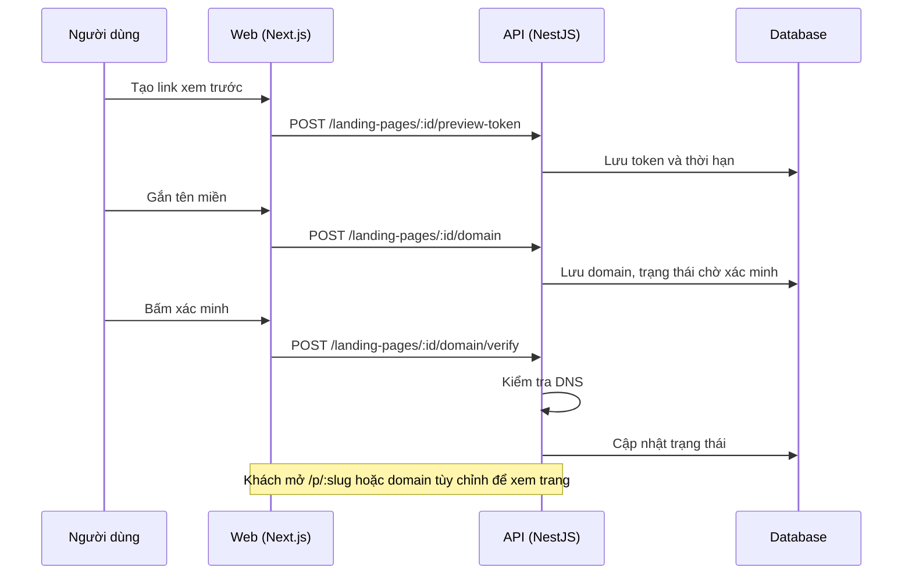

# LP07: Trang công khai, preview, tên miền, SEO

- **Nhóm:** D. Landing Page
- **Mức ưu tiên:** P1
- **Route giao diện:** `/p/[slug], /p/preview/[token], /landing-pages/domain`
- **API chính:**
  - `GET /landing-pages/public/:slug`
  - `GET /landing-pages/public/preview/:token`
  - `POST /landing-pages/:id/preview-token`
  - `POST /landing-pages/:id/domain`
  - `POST /landing-pages/:id/domain/verify`
  - `GET /landing-pages/domains`

## Điều kiện trước khi test

- Một trang đã xuất bản
- Tên miền thử có thể cấu hình DNS

## Sơ đồ sequence

## Các bước test

| # | Bước thực hiện | Kết quả mong đợi | Test tự động |
|---|---|---|---|
| 1 | Mở /p/:slug | Hiển thị giống bản trong builder, giữ meta | `test-landing-page-public-meta-keep.cjs` |
| 2 | Vị trí tự do hiển thị đúng trên trang công khai | Không lệch so với builder | `test-landing-page-public-free-position.cjs` |
| 3 | Kiểm tra URL (URL doctor) | Báo đúng lỗi URL | `test-landing-page-url-doctor.cjs` |
| 4 | Tạo và thu hồi link xem trước | Link hết hạn và thu hồi đúng | Thủ công |
| 5 | Gắn tên miền và xác minh DNS | Trạng thái đúng | Thủ công |
| 6 | SEO: tiêu đề, mô tả, canonical, robots | Có trong HTML | Thủ công |
| 7 | Trang chưa xuất bản | Trả 404 cho khách | Thủ công |

## Trường hợp biên và lỗi cần thử

- Token xem trước hết hạn
- Tên miền đã gắn cho tổ chức khác
- Cache trang công khai chưa làm mới sau khi xuất bản

## Ghi chú

- Cột "Thủ công" nghĩa là chưa thấy test tự động tương ứng. Cần kiểm tra bằng tay hoặc viết test mới.
- Việc ghép test với bước dựa trên tên file, chưa mở đọc từng test. Chưa chạy lại để lấy baseline.
- Test có hậu tố `-live` hoặc `-e2e` gọi dịch vụ ngoài, chỉ chạy khi chủ động.
- Cách chạy và ma trận: `docs/test case/REGRESSION_MATRIX.md`.
