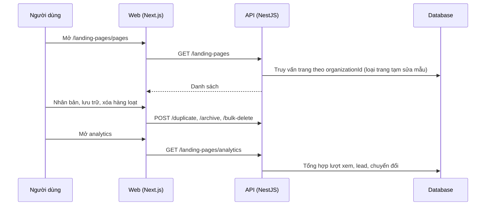

# LP08: Trang của tôi, tổng quan và analytics

- **Nhóm:** D. Landing Page
- **Mức ưu tiên:** P2
- **Route giao diện:** `/landing-pages, /landing-pages/pages, /landing-pages/analytics`
- **API chính:**
  - `GET /landing-pages/overview`
  - `GET /landing-pages`
  - `GET /landing-pages/analytics`
  - `POST /landing-pages/:id/duplicate`
  - `POST /landing-pages/:id/archive`
  - `POST /landing-pages/bulk-delete`

## Điều kiện trước khi test

- Tổ chức có nhiều trang ở các trạng thái

## Sơ đồ sequence

## Các bước test

| # | Bước thực hiện | Kết quả mong đợi | Test tự động |
|---|---|---|---|
| 1 | Bảng danh sách: lọc, tìm, trạng thái | Hiển thị đúng | `test-landing-page-pages-table-redesign.cjs` |
| 2 | Thống kê tổng quan | Số liệu khớp | `test-landing-page-overview-stats.cjs` |
| 3 | Nhân bản một trang | Trang mới độc lập, không chung id phần tử | Thủ công |
| 4 | Lưu trữ và xóa hàng loạt | Chỉ ảnh hưởng trang đã chọn | Thủ công |
| 5 | Analytics lượt xem và chuyển đổi | Số liệu đúng so với sự kiện thật | Thủ công |
| 6 | Trang làm việc sửa mẫu (slug bắt đầu bằng tpl-edit-) không hiện trong danh sách và dashboard | Bị ẩn | Thủ công |

## Trường hợp biên và lỗi cần thử

- Hơn 100 trang (giới hạn danh sách)
- Xóa trang đang có lead
- Tổ chức mới chưa có trang

## Ghi chú

- Cột "Thủ công" nghĩa là chưa thấy test tự động tương ứng. Cần kiểm tra bằng tay hoặc viết test mới.
- Việc ghép test với bước dựa trên tên file, chưa mở đọc từng test. Chưa chạy lại để lấy baseline.
- Test có hậu tố `-live` hoặc `-e2e` gọi dịch vụ ngoài, chỉ chạy khi chủ động.
- Cách chạy và ma trận: `docs/test case/REGRESSION_MATRIX.md`.
