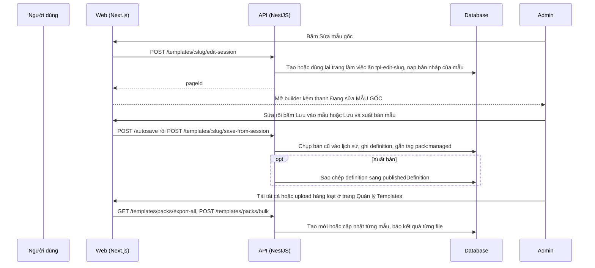

# LP09: Admin: quản lý template (sửa mẫu gốc, tải tất cả, upload hàng loạt)

- **Nhóm:** D. Landing Page
- **Mức ưu tiên:** P1
- **Route giao diện:** `/landing-pages/manage-templates, /landing-pages/templates`
- **API chính:**
  - `POST /landing-pages/templates/:idOrSlug/edit-session`
  - `POST /landing-pages/templates/:idOrSlug/save-from-session`
  - `POST /landing-pages/templates/:idOrSlug/publish`
  - `GET /landing-pages/templates/packs/export-all`
  - `POST /landing-pages/templates/packs/bulk`
  - `GET /landing-pages/templates/:idOrSlug/pack`
  - `POST /landing-pages/templates/:idOrSlug/pack`
  - `GET /landing-pages/templates/:idOrSlug/versions`
  - `POST /landing-pages/templates/:idOrSlug/versions/:version/restore`

## Điều kiện trước khi test

- Tài khoản SUPER_ADMIN
- Một mẫu thử có slug riêng (xóa sau khi test)

## Sơ đồ sequence

## Các bước test

| # | Bước thực hiện | Kết quả mong đợi | Test tự động |
|---|---|---|---|
| 1 | Người không phải SUPER_ADMIN gọi endpoint mẫu admin | Bị chặn | `test-platform-admin-rbac.ts` |
| 2 | Tải một mẫu (ZIP) và tải tất cả | ZIP có manifest và template, tách lại được | `test-landing-page-template-pack.ts` |
| 3 | Upload hàng loạt: tạo mới, cập nhật, lỗi một file không dừng cả lô | Báo kết quả từng file | `test-landing-page-template-bulk-upload.cjs` |
| 4 | Upload trùng, thư mục, mẫu cùng slug | Loại trùng đúng | `test-landing-page-template-bulk-dedup.cjs` |
| 5 | Giao diện upload hàng loạt (thành công, một phần, lỗi) | Báo cáo đúng | `qa-landing-page-template-bulk-ui.cjs` |
| 6 | Giới hạn dung lượng và số file upload | Từ chối khi vượt | `qa-landing-page-upload-limits.cjs` |
| 7 | Mở phiên sửa mẫu hai lần | Dùng lại cùng trang làm việc | Thủ công |
| 8 | Lưu vào mẫu rồi lưu và xuất bản | Mẫu đổi, publishedDefinition khớp, có lịch sử phiên bản | Thủ công |
| 9 | Khởi động lại API khi catalog đổi phiên bản | Mẫu đã sửa tay (pack:managed) không bị ghi đè | Thủ công |
| 10 | Trang khách đã tạo từ mẫu trước đó | Không đổi sau khi sửa mẫu | Thủ công |
| 11 | Xuất bản trang làm việc tpl-edit-* bằng nút Publish thường | Bị API từ chối kèm hướng dẫn | Thủ công |

## Trường hợp biên và lỗi cần thử

- ZIP tổng lớn hơn giới hạn nginx 100MB
- Hai admin cùng sửa một mẫu
- Khôi phục phiên bản mẫu cũ (trạng thái chuyển về nháp)

## Ghi chú

- Cột "Thủ công" nghĩa là chưa thấy test tự động tương ứng. Cần kiểm tra bằng tay hoặc viết test mới.
- Việc ghép test với bước dựa trên tên file, chưa mở đọc từng test. Chưa chạy lại để lấy baseline.
- Test có hậu tố `-live` hoặc `-e2e` gọi dịch vụ ngoài, chỉ chạy khi chủ động.
- Cách chạy và ma trận: `docs/test case/REGRESSION_MATRIX.md`.
