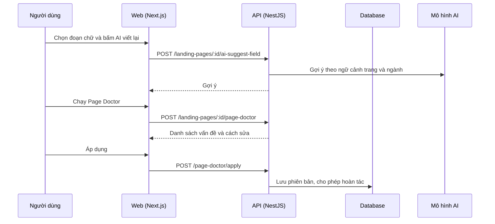

# LP10: AI trong builder (viết lại, Page Doctor, hồ sơ doanh nghiệp)

- **Nhóm:** D. Landing Page
- **Mức ưu tiên:** P2
- **Route giao diện:** `/landing-pages/builder/[id]`
- **API chính:**
  - `POST /landing-pages/:id/ai-suggest-field`
  - `POST /landing-pages/:id/page-doctor`
  - `POST /landing-pages/:id/page-doctor/apply`
  - `POST /landing-pages/:id/apply-business-profile`
  - `GET /landing-pages/business-profile`

## Điều kiện trước khi test

- Hồ sơ doanh nghiệp đã nhập
- Đủ credit AI

## Sơ đồ sequence

## Các bước test

| # | Bước thực hiện | Kết quả mong đợi | Test tự động |
|---|---|---|---|
| 1 | AI viết lại tại chỗ | Gợi ý đúng ngữ cảnh, chỉ thay đoạn chọn | `test-landing-page-inline-ai.cjs` |
| 2 | Ngữ cảnh gửi cho AI | Có ngành, tiêu đề, đoạn lân cận | `test-landing-page-inline-ai-context.cjs` |
| 3 | Áp hồ sơ doanh nghiệp vào trang | Điền đúng thông tin, không ghi đè bừa | `test-landing-page-business-profile.cjs` |
| 4 | Page Doctor kiểm tra và áp dụng | Sửa đúng, hoàn tác được | `test-landing-page-doctor-gates.cjs` |
| 5 | Hết credit khi dùng AI | Báo rõ, không làm hỏng trang | Thủ công |

## Trường hợp biên và lỗi cần thử

- AI trả nội dung sai ngôn ngữ
- Áp dụng Page Doctor rồi hoàn tác
- Doctor trên trang rất dài

## Ghi chú

- Cột "Thủ công" nghĩa là chưa thấy test tự động tương ứng. Cần kiểm tra bằng tay hoặc viết test mới.
- Việc ghép test với bước dựa trên tên file, chưa mở đọc từng test. Chưa chạy lại để lấy baseline.
- Test có hậu tố `-live` hoặc `-e2e` gọi dịch vụ ngoài, chỉ chạy khi chủ động.
- Cách chạy và ma trận: `docs/test case/REGRESSION_MATRIX.md`.
