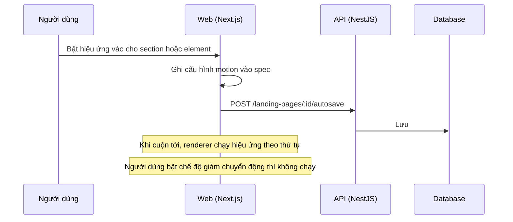

# LP11: Hiệu ứng (motion) cho section và element

- **Nhóm:** D. Landing Page
- **Mức ưu tiên:** P2
- **Route giao diện:** `/landing-pages/builder/[id], /p/[slug]`
- **API chính:**
  - `POST /landing-pages/:id/autosave`

## Điều kiện trước khi test

- Trang có section và element

## Sơ đồ sequence

## Các bước test

| # | Bước thực hiện | Kết quả mong đợi | Test tự động |
|---|---|---|---|
| 1 | Bật hiệu ứng và xem trước | Chạy đúng kiểu, đúng thời lượng | `test-landing-page-motion.cjs` |
| 2 | Hiệu ứng trên builder thật | Không lỗi, không giật | `qa-landing-page-motion-browser.cjs` |
| 3 | Hiệu ứng nối tiếp (cascade) | Thứ tự đúng | `qa-landing-page-motion-cascade-browser.cjs` |
| 4 | Hiệu ứng mặc định tắt (chỉ bật khi chọn) | Trang cũ không tự có hiệu ứng | Thủ công |
| 5 | prefers-reduced-motion | Tắt hiệu ứng | Thủ công |

## Trường hợp biên và lỗi cần thử

- Nhiều hiệu ứng cùng lúc trên mobile yếu
- Hiệu ứng làm tràn ngang

## Ghi chú

- Cột "Thủ công" nghĩa là chưa thấy test tự động tương ứng. Cần kiểm tra bằng tay hoặc viết test mới.
- Việc ghép test với bước dựa trên tên file, chưa mở đọc từng test. Chưa chạy lại để lấy baseline.
- Test có hậu tố `-live` hoặc `-e2e` gọi dịch vụ ngoài, chỉ chạy khi chủ động.
- Cách chạy và ma trận: `docs/test case/REGRESSION_MATRIX.md`.
