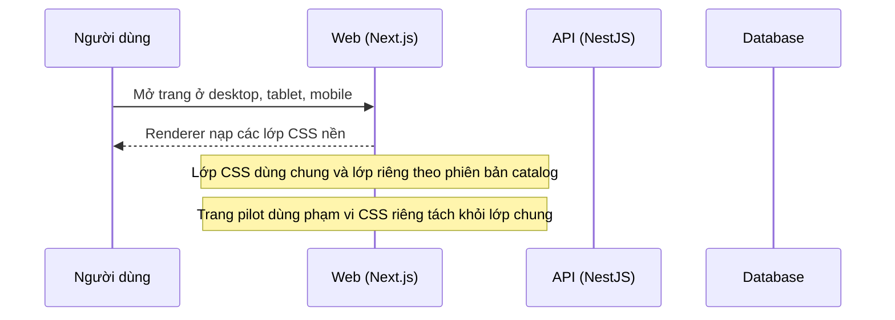

# LP12: Chất lượng giao diện toàn cục (responsive, hình ảnh)

- **Nhóm:** D. Landing Page
- **Mức ưu tiên:** P1
- **Route giao diện:** `Mọi trang landing page`
- **API chính:**
  - (không có endpoint riêng, chủ yếu kiểm tra hiển thị)

## Điều kiện trước khi test

- Container web chạy ảnh hiện tại

## Sơ đồ sequence

## Các bước test

| # | Bước thực hiện | Kết quả mong đợi | Test tự động |
|---|---|---|---|
| 1 | Responsive nhóm agency | Không tràn ngang, không vỡ | `qa-landing-page-agency-responsive.cjs` |
| 2 | Responsive nhóm spa | Không tràn ngang, không vỡ | `qa-landing-page-spa-responsive.cjs` |
| 3 | Responsive lô 1 và lô 2 | Không tràn ngang | `qa-landing-page-batch1-responsive.cjs` |
| 4 | Kiểm tra hình ảnh toàn cục | Ảnh đúng ngành, không lỗi | `qa-landing-page-global-visual.cjs` |
| 5 | Kiểm tra thiết kế | Đạt tiêu chí | `test-landing-page-design-audit.cjs` |
| 6 | Audit 200 mẫu × 3 khung hình | Không lỗi tràn ngang, đủ form | Thủ công |

## Trường hợp biên và lỗi cần thử

- Ảnh hotlink không tải được
- Chữ dài làm vỡ thẻ
- Mẫu pilot bị CSS chung ảnh hưởng

## Ghi chú

- Cột "Thủ công" nghĩa là chưa thấy test tự động tương ứng. Cần kiểm tra bằng tay hoặc viết test mới.
- Việc ghép test với bước dựa trên tên file, chưa mở đọc từng test. Chưa chạy lại để lấy baseline.
- Test có hậu tố `-live` hoặc `-e2e` gọi dịch vụ ngoài, chỉ chạy khi chủ động.
- Cách chạy và ma trận: `docs/test case/REGRESSION_MATRIX.md`.
