# TỔNG QUAN HỆ THỐNG 58 FLOWS NGHIỆP VỤ AIBEEGO (MARKETING SPA)

> **Thư mục lưu trữ**: `D:\Backup VPS\Backup new\aibeego\review-code\Flow`  
> **Nguyên tắc cốt lõi**: "CÓ A THÌ MỚI CÓ B" — Tất cả 58 luồng được phân tách thành từng file markdown độc lập và sắp xếp theo thứ tự phụ thuộc vòng đời (Lifecycle & Topological Dependency Order).

---

## 1. BẢN ĐỒ CÂY PHỤ THUỘC TỔNG THỂ (LIFECYCLE DEPENDENCY GRAPH)

```mermaid
flowchart TD
    %% TẦNG 0 & 1: HẠ TẦNG & XÁC THỰC
    subgraph L0_L1["TẦNG 0 & 1: NỀN TẢNG & ĐỊNH DANH"]
        F001["FLOW-001: Khởi động Hạ tầng Docker & Microservices"] --> F002["FLOW-002: Migration DB & Seed Permissions/Roles"]
        F002 --> F003["FLOW-003: Đăng ký Tài khoản (Register & OTP)"]
        F003 --> F004["FLOW-004: Xác thực & Đăng nhập (Login & JWT Token)"]
        F004 --> F005["FLOW-005: Quên & Đặt lại mật khẩu (Password Reset)"]
        F004 --> F006["FLOW-006: Quản lý Phiên & Hồ sơ (User Profile)"]
    end

    %% TẦNG 2: TỔ CHỨC & BẢN QUYỀN
    subgraph L2["TẦNG 2: THIẾT LẬP TỔ CHỨC & GÓI CƯỚC"]
        F004 --> F007["FLOW-007: Khởi tạo Tổ chức & Business Profile"]
        F007 --> F008["FLOW-008: Khởi tạo Chi nhánh (Branches)"]
        F007 --> F009["FLOW-009: Phân quyền & Quản lý Vai trò (RBAC)"]
        F007 --> F010["FLOW-010: Đăng ký Gói cước (Subscription & Trial)"]
        F010 --> F011["FLOW-011: Nạp ví Credit & Trừ điểm AI (Credit Metering)"]
    end

    %% TẦNG 3: TÍCH HỢP ĐA KÊNH
    subgraph L3["TẦNG 3: KẾT NỐI TÍCH HỢP NGOẠI VI"]
        F007 --> F012["FLOW-012: Kết nối Meta Fanpage & Ads Account"]
        F007 --> F013["FLOW-013: Kết nối Zalo Official Account (OA & ZNS)"]
        F007 --> F014["FLOW-014: Cấu hình Tên miền gửi Email & SMTP/SES"]
        F007 --> F015["FLOW-015: Cổng thanh toán & Biến động số dư VietQR/SePAY"]
    end

    %% TẦNG 4: DANH MỤC SẢN PHẨM & KHO
    subgraph L4["TẦNG 4: DANH MỤC, DỊCH VỤ & KHO HÀNG"]
        F007 --> F016["FLOW-016: Quản lý Sản phẩm, Danh mục & Đồng bộ WooCommerce"]
        F008 --> F017["FLOW-017: Quản lý Dịch vụ Spa, Phòng & Giường"]
        F016 --> F018["FLOW-018: Quản lý Nhà cung cấp & Đơn mua hàng (PO)"]
        F018 --> F019["FLOW-019: Nhập kho, Quản lý Lô/Hạn dùng (Stock Batch FIFO)"]
        F019 --> F020["FLOW-020: Quản trị Tồn kho, Kiểm kê & Cân đối (Stocktake)"]
    end

    %% TẦNG 5: PHỄU & LANDING PAGE
    subgraph L5["TẦNG 5: LANDING PAGE & PHỄU CHUYỂN ĐỔI"]
        F016 & F017 --> F021["FLOW-021: Thiết kế Landing Page (Visual Builder & AI)"]
        F021 --> F022["FLOW-022: Thiết lập Phễu chuyển đổi (Funnel Pipeline)"]
        F021 --> F023["FLOW-023: Gắn Tên miền riêng & Tracking Pixels"]
        F023 --> F024["FLOW-024: Xuất bản Landing Page & CDN Revalidate"]
        F024 --> F025["FLOW-025: Khách truy cập Landing Page & Điền Form"]
    end

    %% TẦNG 6: CRM & QUẢN TRỊ LEAD
    subgraph L6["TẦNG 6: QUẢN TRỊ KHÁCH HÀNG & PHÂN LOẠI LEAD"]
        F025 --> F026["FLOW-026: Tiếp nhận Lead, Khử trùng lặp & Hợp nhất Khách"]
        F026 --> F027["FLOW-027: Phân bổ Lead tự động (Lead Assignment)"]
        F027 --> F028["FLOW-028: Chấm điểm Tiềm năng (Scoring) & Giai đoạn Phễu"]
        F028 --> F029["FLOW-029: Chăm sóc Lead, Ghi chú & Lịch nhắc việc (CRM Task)"]
    end

    %% TẦNG 7: ĐẶT LỊCH HẸN
    subgraph L7["TẦNG 7: ĐẶT LỊCH DỊCH VỤ & VẬN HÀNH SPA"]
        F017 & F026 --> F030["FLOW-030: Đặt Lịch hẹn Dịch vụ (Check phòng & KTV)"]
        F030 --> F031["FLOW-031: Xác nhận & Tự động nhắc lịch (Zalo/Email Reminders)"]
        F031 --> F032["FLOW-032: Check-in, Thực hiện Dịch vụ & Hoàn tất"]
    end

    %% TẦNG 8: BÁN HÀNG & THANH TOÁN
    subgraph L8["TẦNG 8: BÁN HÀNG, COUPON, ĐƠN HÀNG & THANH TOÁN"]
        F016 --> F033["FLOW-033: Thiết lập Mã Giảm Giá (Coupons & Promotions)"]
        F019 & F033 & F026 --> F034["FLOW-034: Tạo Đơn hàng Bán lẻ & Áp dụng Coupon"]
        F032 --> F034
        F034 & F015 --> F035["FLOW-035: Thanh toán Đơn hàng & Tự động Đối soát (Payment)"]
        F035 --> F036["FLOW-036: Xuất kho Giao hàng & Trừ Tồn kho (Stock Movement OUT)"]
        F036 --> F037["FLOW-037: Đổi trả hàng, Hoàn tiền & Nhập lại kho (Sales Return)"]
    end

    %% TẦNG 9: MARKETING & QUẢNG CÁO
    subgraph L9["TẦNG 9: MARKETING TỰ ĐỘNG & QUẢNG CÁO ĐA KÊNH"]
        F011 & F012 --> F038["FLOW-038: Sáng tạo Nội dung AI & Đăng bài tự động Fanpage/Zalo"]
        F012 & F025 --> F039["FLOW-039: AI Ads Manager (Facebook/Google Ads & Autopilot)"]
        F014 & F026 --> F040["FLOW-040: Chiến dịch Email Marketing & Automation Drip"]
        F013 & F026 --> F041["FLOW-041: Chiến dịch Tin nhắn Zalo ZNS & Messaging Broadcast"]
        F035 & F039 --> F042["FLOW-042: Đo lường Phân bổ (Attribution) & Offline Conversion CAPI"]
    end

    %% TẦNG 10: CHATBOT CSKH
    subgraph L10["TẦNG 10: TRỢ LÝ AI & CHATBOT CSKH THÔNG MINH"]
        F011 --> F043["FLOW-043: Xây dựng Cơ sở Tri thức Doanh nghiệp (RAG Knowledge Base)"]
        F043 & F012 --> F044["FLOW-044: Cấu hình Chatbot CSKH Đa kênh (Prompt, Thu lead)"]
        F044 --> F045["FLOW-045: Vận hành Tự động Trả lời CSKH & Bàn giao Tư vấn viên"]
        F045 --> F026
    end

    %% TẦNG 11: AFFILIATE
    subgraph L11["TẦNG 11: TIẾP THỊ LIÊN KẾT (AFFILIATE)"]
        F007 --> F046["FLOW-046: Đăng ký Đối tác Affiliate & Cấp mã/Link giới thiệu"]
        F046 & F035 --> F047["FLOW-047: Ghi nhận Đơn giới thiệu & Tính Hoa hồng (Commission)"]
        F047 --> F048["FLOW-048: Yêu cầu Rút tiền & Quyết toán Hoa hồng (Payout)"]
    end

    %% TẦNG 12: NHÂN SỰ & CHẤM CÔNG
    subgraph L12["TẦNG 12: QUẢN TRỊ NHÂN SỰ & CHẤM CÔNG (HRM)"]
        F008 & F009 --> F049["FLOW-049: Quản lý Nhân sự, Hồ sơ & Hợp đồng Lao động"]
        F049 --> F050["FLOW-050: Phân ca Làm việc & Chính sách Ca (Shift Assignment)"]
        F050 --> F051["FLOW-051: Chấm công bằng Mã QR Động / Vị trí (QR Punch)"]
        F051 --> F052["FLOW-052: Quản lý Nghỉ phép, Tăng ca & Chốt Bảng công"]
    end

    %% TẦNG 13: QUẢN LÝ CÔNG VIỆC
    subgraph L13["TẦNG 13: QUẢN TRỊ DỰ ÁN & TIẾN ĐỘ CÔNG VIỆC"]
        F049 --> F053["FLOW-053: Khởi tạo Dự án & Bảng Công việc (Kanban Board)"]
        F053 --> F054["FLOW-054: Giao việc, Checklist, Tiến độ & Log thời gian"]
        F054 --> F055["FLOW-055: Đánh giá, Phê duyệt & Đóng Task"]
    end

    %% TẦNG 14: TÀI CHÍNH & MỤC TIÊU DOANH NGHIỆP
    subgraph L14["TẦNG 14: TÀI CHÍNH, BÁO CÁO & MỤC TIÊU KINH DOANH"]
        F035 & F052 --> F056["FLOW-056: Quản lý Thu - Chi & Sổ quỹ Dòng tiền (Finance & Cashflow)"]
        F056 --> F057["FLOW-057: Thiết lập Mục tiêu Kinh doanh & Kịch bản Doanh thu"]
        F056 & F042 --> F058["FLOW-058: Báo cáo Tổng thể Doanh nghiệp (BI Dashboard) & Audit Log"]
    end
```

---

## 2. DANH SÁCH CHI TIẾT TỪNG FILE FLOW (.MD)

### TẦNG 0: HẠ TẦNG & KHỞI TẠO NỀN TẢNG (INFRASTRUCTURE & SYSTEM SEED)
1. [**FLOW-001**: Khởi động Hạ tầng Docker & Kết nối Microservices](./FLOW-001-khoi-dong-ha-tang-docker-ket-noi-microservices.md)
2. [**FLOW-002**: Khởi tạo Database Schema & Seed Dữ liệu Gốc](./FLOW-002-khoi-tao-database-schema-seed-du-lieu-goc.md)

### TẦNG 1: QUẢN TRỊ DANH TÍNH & XÁC THỰC (IAM - IDENTITY & AUTHENTICATION)
3. [**FLOW-003**: Đăng ký Tài khoản Người dùng mới (User Registration)](./FLOW-003-dang-ky-tai-khoan-nguoi-dung-moi.md)
4. [**FLOW-004**: Xác thực & Đăng nhập Hệ thống (Authentication & Login)](./FLOW-004-xac-thuc-dang-nhap-he-thong.md)
5. [**FLOW-005**: Quên mật khẩu & Khôi phục Tài khoản (Password Reset)](./FLOW-005-quen-mat-khau-khoi-phuc-tai-khoan.md)
6. [**FLOW-006**: Quản lý Hồ sơ & Phiên Đăng nhập (User Profile & Active Sessions)](./FLOW-006-quan-ly-ho-so-phien-dang-nhap.md)

### TẦNG 2: THIẾT LẬP TỔ CHỨC, GÓI CƯỚC & PHÂN QUYỀN (ORGANIZATION, SUBSCRIPTION & RBAC)
7. [**FLOW-007**: Khởi tạo & Cấu hình Tổ chức / Doanh nghiệp (Organization Setup)](./FLOW-007-khoi-tao-cau-hinh-to-chuc-doanh-nghiep.md)
8. [**FLOW-008**: Cấu hình Chi nhánh & Cơ sở Vận hành (Branches Management)](./FLOW-008-cau-hinh-chi-nhanh-co-so-van-hanh.md)
9. [**FLOW-009**: Phân quyền & Quản lý Vai trò Đội ngũ (RBAC - Roles & Permissions)](./FLOW-009-phan-quyen-quan-ly-vai-tro-doi-ngu.md)
10. [**FLOW-010**: Đăng ký Gói cước (Subscription & Trial Claim)](./FLOW-010-dang-ky-goi-cuoc.md)
11. [**FLOW-011**: Nạp ví Credit & Trừ điểm dịch vụ AI (Credit Wallet & Usage Metering)](./FLOW-011-nap-vi-credit-tru-diem-dich-vu-ai.md)

### TẦNG 3: KẾT NỐI KÊNH BÊN NGOÀI & TÍCH HỢP (INTEGRATIONS & EXTERNAL CHANNELS)
12. [**FLOW-012**: Kết nối Meta Fanpage & Facebook Ads (Meta Integration)](./FLOW-012-ket-noi-meta-fanpage-facebook-ads.md)
13. [**FLOW-013**: Kết nối Zalo Official Account (Zalo OA & ZNS Integration)](./FLOW-013-ket-noi-zalo-official-account.md)
14. [**FLOW-014**: Cấu hình Tên miền gửi Email & Dịch vụ Gửi thư (Email Sender Setup)](./FLOW-014-cau-hinh-ten-mien-gui-email-dich-vu-gui-thu.md)
15. [**FLOW-015**: Cổng Thanh toán & Tự động Đối soát Ngân hàng (Payment Gateway & SePAY)](./FLOW-015-cong-thanh-toan-tu-dong-doi-soat-ngan-hang.md)

### TẦNG 4: DANH MỤC SẢN PHẨM, DỊCH VỤ & QUẢN TRỊ KHO (CATALOG, SERVICES & INVENTORY)
16. [**FLOW-016**: Quản lý Sản phẩm, Danh mục & Đồng bộ Bán lẻ (Sales Products & Catalog)](./FLOW-016-quan-ly-san-pham-danh-muc-dong-bo-ban-le.md)
17. [**FLOW-017**: Quản lý Dịch vụ Spa, Phòng & Giường (Services, Spa Rooms & Beds)](./FLOW-017-quan-ly-dich-vu-spa-phong-giuong.md)
18. [**FLOW-018**: Quản lý Nhà cung cấp & Tạo Đơn mua hàng (Suppliers & Purchase Orders)](./FLOW-018-quan-ly-nha-cung-cap-tao-don-mua-hang.md)
19. [**FLOW-019**: Nhập kho, Quản lý Lô & Hạn sử dụng (Inward Stock & Batch Management)](./FLOW-019-nhap-kho-quan-ly-lo-han-su-dung.md)
20. [**FLOW-020**: Quản trị Tồn kho Đa chi nhánh, Kiểm kê & Cân đối (Stocktake & Reconciliation)](./FLOW-020-quan-tri-ton-kho-da-chi-nhanh-kiem-ke-can-doi.md)

### TẦNG 5: THIẾT KẾ & XUẤT BẢN LANDING PAGE / PHỄU (LANDING PAGES & FUNNEL CONVERSION)
21. [**FLOW-021**: Thiết kế Landing Page bằng Visual Builder & AI Generator](./FLOW-021-thiet-ke-landing-page-bang-visual-builder-ai-generator.md)
22. [**FLOW-022**: Thiết lập Phễu Chuyển Đổi Đa Bước (Multi-Step Funnel Pipeline)](./FLOW-022-thiet-lap-pheu-chuyen-doi-da-buoc.md)
23. [**FLOW-023**: Gắn Tên Miền Riêng & Cài Đặt Tracking Pixels](./FLOW-023-gan-ten-mien-rieng-cai-dat-tracking-pixels.md)
24. [**FLOW-024**: Xuất Bản Landing Page & Tối Ưu CDN Caching (Publishing)](./FLOW-024-xuat-ban-landing-page-toi-uu-cdn-caching.md)
25. [**FLOW-025**: Khách Truy Cập Landing Page & Điền Form Đăng Ký (Lead Capture)](./FLOW-025-khach-truy-cap-landing-page-dien-form-dang-ky.md)

### TẦNG 6: QUẢN LÝ QUAN HỆ KHÁCH HÀNG & PHÂN LOẠI LEAD (CRM & LEAD NURTURING)
26. [**FLOW-026**: Tiếp Nhận Lead, Khử Trùng Lặp & Hợp Nhất Khách Hàng (Lead Ingestion & Deduplication)](./FLOW-026-tiep-nhan-lead-khu-trung-lap-hop-nhat-khach-hang.md)
27. [**FLOW-027**: Phân Bổ Lead Tự Động Cho Nhân Viên Kinh Doanh (Lead Assignment Engine)](./FLOW-027-phan-bo-lead-tu-dong-cho-nhan-vien-kinh-doanh.md)
28. [**FLOW-028**: Chấm Điểm Tiềm Năng & Quản Lý Giai Đoạn Phễu (Lead Scoring & Pipeline)](./FLOW-028-cham-diem-tiem-nang-quan-ly-giai-doan-pheu.md)
29. [**FLOW-029**: Chăm Sóc Lead, Ghi Chú & Lịch Nhắc Việc (Lead Notes & CRM Tasks)](./FLOW-029-cham-soc-lead-ghi-chu-lich-nhac-viec.md)

### TẦNG 7: ĐẶT LỊCH HẸN & VẬN HÀNH DỊCH VỤ (APPOINTMENTS & SPA OPERATIONS)
30. [**FLOW-030**: Đặt Lịch Hẹn Dịch Vụ (Appointment Booking)](./FLOW-030-dat-lich-hen-dich-vu.md)
31. [**FLOW-031**: Xác Nhận & Tự Động Nhắc Lịch (Confirmation & Automated Reminders)](./FLOW-031-xac-nhan-tu-dong-nhac-lich.md)
32. [**FLOW-032**: Check-in, Thực Hiện Dịch vụ & Hoàn Tất Liệu Trình (In-Service & Completion)](./FLOW-032-check-in-thuc-hien-dich-vu-hoan-tat-lieu-trinh.md)

### TẦNG 8: BÁN HÀNG, KHUYẾN MÃI, ĐƠN HÀNG & THANH TOÁN (SALES, COUPONS, ORDERS & PAYMENTS)
33. [**FLOW-033**: Thiết Lập Mã Giảm Giá & Chính Sách Khuyến Mãi (Coupons & Promotions)](./FLOW-033-thiet-lap-ma-giam-gia-chinh-sach-khuyen-mai.md)
34. [**FLOW-034**: Tạo Đơn Hàng Bán Lẻ & Áp Dụng Mã Giảm Giá (Order Creation with Coupon)](./FLOW-034-tao-don-hang-ban-le-ap-dung-ma-giam-gia.md)
35. [**FLOW-035**: Xử Lý Thanh Toán Đơn Hàng & Tự Động Đối Soát (Payment Processing)](./FLOW-035-xu-ly-thanh-toan-don-hang-tu-dong-doi-soat.md)
36. [**FLOW-036**: Xuất Kho Giao Hàng & Trừ Tồn Kho Tự Động (Fulfillment & Stock Movement)](./FLOW-036-xuat-kho-giao-hang-tru-ton-kho-tu-dong.md)
37. [**FLOW-037**: Đổi Trả Hàng, Hoàn Tiền & Nhập Lại Kho (Sales Returns & Refunds)](./FLOW-037-doi-tra-hang-hoan-tien-nhap-lai-kho.md)

### TẦNG 9: MARKETING ĐA KÊNH & CHIẾN DỊCH TỰ ĐỘNG (OMNICHANNEL MARKETING & AUTOPILOT)
38. [**FLOW-038**: Sáng Tạo Nội Dung & Lên Lịch Đăng Bài Tự Động (Content Marketing & Auto-Post)](./FLOW-038-sang-tao-noi-dung-len-lich-dang-bai-tu-dong.md)
39. [**FLOW-039**: Quản Trị & Vận Hành Chiến Dịch Quảng Cáo AI (AI Ads Manager & Autopilot)](./FLOW-039-quan-tri-van-hanh-chien-dich-quang-cao-ai.md)
40. [**FLOW-040**: Chiến Dịch Email Marketing & Chuỗi Tự Động (Email Marketing & Drip Automation)](./FLOW-040-chien-dich-email-marketing-chuoi-tu-dong.md)
41. [**FLOW-041**: Chiến Dịch Tin Nhắn Zalo ZNS & Messaging Broadcast](./FLOW-041-chien-dich-tin-nhan-zalo-zns-messaging-broadcast.md)
42. [**FLOW-042**: Đo Lường Nguồn Gốc & Phân Bổ Chuyển Đổi (Attribution & Meta CAPI)](./FLOW-042-do-luong-nguon-goc-phan-bo-chuyen-doi.md)

### TẦNG 10: CHĂM SÓC KHÁCH HÀNG THÔNG MINH VỚI AI & CHATBOT (AI CSKH & RAG KNOWLEDGE BASE)
43. [**FLOW-043**: Xây Dựng Cơ Sở Tri Thức Doanh Nghiệp (RAG Knowledge Base)](./FLOW-043-xay-dung-co-so-tri-thuc-doanh-nghiep.md)
44. [**FLOW-044**: Cấu Hình Chatbot CSKH Đa Kênh (Chatbot Setup)](./FLOW-044-cau-hinh-chatbot-cskh-da-kenh.md)
45. [**FLOW-045**: Tự Động Trả Lời CSKH & Bàn Giao Tư Vấn Viên (AI Auto-Reply & Human Handoff)](./FLOW-045-tu-dong-tra-loi-cskh-ban-giao-tu-van-vien.md)

### TẦNG 11: TIẾP THỊ LIÊN KẾT (AFFILIATE MARKETING)
46. [**FLOW-046**: Đăng Ký Đối Tác Tiếp Thị & Cấp Link Giới Thiệu (Affiliate Onboarding)](./FLOW-046-dang-ky-doi-tac-tiep-thi-cap-link-gioi-thieu.md)
47. [**FLOW-047**: Ghi Nhận Lượt Nhấp & Tính Hoa Hồng Đơn Hàng (Click Tracking & Commission)](./FLOW-047-ghi-nhan-luot-nhap-tinh-hoa-hong-don-hang.md)
48. [**FLOW-048**: Yêu Cầu Rút Tiền & Quyết Toán Hoa Hồng (Payout Request & Settlement)](./FLOW-048-yeu-cau-rut-tien-quyet-toan-hoa-hong.md)

### TẦNG 12: QUẢN TRỊ NHÂN SỰ, CA KÍP & CHẤM CÔNG (HRM & ATTENDANCE MANAGEMENT)
49. [**FLOW-049**: Quản Lý Hồ Sơ Nhân Sự & Hợp Đồng Lao Động (Employee Lifecycle)](./FLOW-049-quan-ly-ho-so-nhan-su-hop-dong-lao-dong.md)
50. [**FLOW-050**: Phân Ca Làm Việc & Lập Lịch Trực (Work Shift Policies & Shift Assignment)](./FLOW-050-phan-ca-lam-viec-lap-lich-truc.md)
51. [**FLOW-051**: Chấm Công Bằng Mã QR Động / Vị Trí GPS (QR Attendance Punch)](./FLOW-051-cham-cong-bang-ma-qr-dong-vi-tri-gps.md)
52. [**FLOW-052**: Quản Lý Nghỉ Phép, Tăng Ca & Chốt Bảng Công Tháng (Leave, Overtime & Timesheet)](./FLOW-052-quan-ly-nghi-phep-tang-ca-chot-bang-cong-thang.md)

### TẦNG 13: QUẢN TRỊ DỰ ÁN & TIẾN ĐỘ CÔNG VIỆC (WORK MANAGEMENT - KANBAN & TASKS)
53. [**FLOW-053**: Khởi Tạo Dự Án & Bảng Công Việc Kanban (Work Projects & Boards)](./FLOW-053-khoi-tao-du-an-bang-cong-viec-kanban.md)
54. [**FLOW-054**: Giao Việc, Checklist, Tiến Độ & Log Thời Gian (Task Execution & Time Tracking)](./FLOW-054-giao-viec-checklist-tien-do-log-thoi-gian.md)
55. [**FLOW-055**: Đánh Giá, Phê Duyệt & Đóng Công Việc (Task Review & Completion)](./FLOW-055-danh-gia-phe-duyet-dong-cong-viec.md)

### TẦNG 14: TÀI CHÍNH, BÁO CÁO & MỤC TIÊU KINH DOANH (FINANCE, ANALYTICS & BUSINESS GOALS)
56. [**FLOW-056**: Quản Lý Thu - Chi & Sổ Quỹ Dòng Tiền (Finance & Cashflow Ledger)](./FLOW-056-quan-ly-thu-chi-so-quy-dong-tien.md)
57. [**FLOW-057**: Thiết Lập Mục Tiêu Kinh Doanh & Phân Tích Kịch Bản (Business Goals & Scenario Simulation)](./FLOW-057-thiet-lap-muc-tieu-kinh-doanh-phan-tich-kich-ban.md)
58. [**FLOW-058**: Báo Cáo Tổng Thể Doanh Nghiệp & Nhật Ký Kiểm Toán (BI Dashboard & Audit Log)](./FLOW-058-bao-cao-tong-the-doanh-nghiep-nhat-ky-kiem-toan.md)

---

## 3. BẢNG MA TRẬN PHỤ THUỘC TỔNG HỢP (DEPENDENCY MATRIX)

| Mã Flow | Tên Flow Nghiệp Vụ | Điều Kiện Tiên Quyết Bắt Buộc ("Có A") | Mở Khóa Tính Năng Tiếp Theo ("Mới Có B") |
| :--- | :--- | :--- | :--- |
| **FLOW-001** | Khởi động Hạ tầng Docker & Microservices | Máy chủ / Docker Engine sẵn sàng | FLOW-002 |
| **FLOW-002** | Migration DB & Seed Permissions/Roles | FLOW-001 (PostgreSQL online) | FLOW-003, FLOW-004 |
| **FLOW-003** | Đăng ký Tài khoản Người dùng | FLOW-002 (Có bảng User/OTP) | FLOW-004 |
| **FLOW-004** | Xác thực & Đăng nhập (JWT Token) | FLOW-003 (Đã có tài khoản) | Tầng 2 -> Tầng 14 |
| **FLOW-005** | Quên & Đặt lại Mật khẩu | FLOW-003 (Tài khoản tồn tại) | FLOW-004 |
| **FLOW-006** | Quản lý Phiên & Hồ sơ Cá nhân | FLOW-004 (Đã đăng nhập) | Bảo mật tài khoản |
| **FLOW-007** | Khởi tạo Tổ chức & Business Profile | FLOW-004 (Đã đăng nhập) | FLOW-008, 009, 010, 012 -> 015 |
| **FLOW-008** | Khởi tạo Chi nhánh (Branches) | FLOW-007 (Có tổ chức) | FLOW-017, FLOW-020, FLOW-049 |
| **FLOW-009** | Phân quyền & Quản lý Vai trò (RBAC) | FLOW-007 (Có tổ chức) | FLOW-027, FLOW-049 |
| **FLOW-010** | Đăng ký Gói cước (Subscription/Trial) | FLOW-007 (Có tổ chức) | FLOW-011, FLOW-021, FLOW-038 |
| **FLOW-011** | Nạp ví Credit & Trừ điểm AI | FLOW-010 (Gói cước kích hoạt) | FLOW-021, FLOW-038, FLOW-043 |
| **FLOW-012** | Kết nối Meta Fanpage & Ads Account | FLOW-007 (Có tổ chức) | FLOW-038, FLOW-039, FLOW-044 |
| **FLOW-013** | Kết nối Zalo Official Account (OA/ZNS) | FLOW-007 (Có tổ chức) | FLOW-031, FLOW-041 |
| **FLOW-014** | Tên miền gửi Email & Dịch vụ gửi thư | FLOW-007 (Có tổ chức & Domain riêng) | FLOW-040 |
| **FLOW-015** | Cổng thanh toán & Webhook VietQR/SePAY | FLOW-007 (Có tổ chức & STK) | FLOW-010, FLOW-011, FLOW-035 |
| **FLOW-016** | Quản lý Danh mục & Sản phẩm bán lẻ | FLOW-007 (Có tổ chức) | FLOW-018, FLOW-021, FLOW-033, 034 |
| **FLOW-017** | Quản lý Dịch vụ Spa, Phòng & Giường | FLOW-008 (Có chi nhánh) | FLOW-021, FLOW-030 |
| **FLOW-018** | Quản lý Nhà cung cấp & Đơn mua hàng (PO) | FLOW-016 (Có sản phẩm cần mua) | FLOW-019 |
| **FLOW-019** | Nhập kho, Quản lý Lô & Hạn sử dụng | FLOW-018 (Có PO được duyệt) | FLOW-020, FLOW-034, FLOW-036 |
| **FLOW-020** | Tồn kho Đa chi nhánh, Kiểm kê & Cân đối | FLOW-019 (Có tồn kho) | Đảm bảo tính toàn vẹn kho |
| **FLOW-021** | Thiết kế Landing Page (Visual & AI) | FLOW-010, 011, 016/017 | FLOW-022, FLOW-023 |
| **FLOW-022** | Thiết lập Phễu chuyển đổi (Funnel Pipeline) | FLOW-021 (Có các trang thành phần) | FLOW-023, FLOW-025 |
| **FLOW-023** | Gắn Tên miền riêng & Tracking Pixels | FLOW-021 / FLOW-022 | FLOW-024 |
| **FLOW-024** | Xuất bản Landing Page & CDN Cache | FLOW-023 (Hoàn tất cấu hình) | FLOW-025, FLOW-039 |
| **FLOW-025** | Khách truy cập Landing Page & Điền Form | FLOW-024 (Trang trực tuyến) | FLOW-026 |
| **FLOW-026** | Tiếp nhận Lead, Khử trùng lặp & Hợp nhất | FLOW-025 (Có lead gửi về) | FLOW-027, FLOW-030, FLOW-034 |
| **FLOW-027** | Phân bổ Lead tự động cho Sales | FLOW-026 (Có lead) & FLOW-049 (Có sales) | FLOW-028, FLOW-029 |
| **FLOW-028** | Chấm điểm Tiềm năng & Giai đoạn Phễu | FLOW-027 (Lead có người phụ trách) | FLOW-029, FLOW-030, FLOW-034 |
| **FLOW-029** | Chăm sóc Lead, Ghi chú & Lịch nhắc việc | FLOW-028 (Lead đang chăm sóc) | FLOW-030, FLOW-034 |
| **FLOW-030** | Đặt Lịch hẹn Dịch vụ Spa | FLOW-017 (Dịch vụ) & FLOW-026 (Khách) | FLOW-031 |
| **FLOW-031** | Xác nhận & Tự động nhắc lịch Zalo/Email | FLOW-030 (Có lịch) & FLOW-013/014 | FLOW-032 |
| **FLOW-032** | Check-in, Thực hiện Dịch vụ & Hoàn tất | FLOW-031 (Khách đến cơ sở) | FLOW-034 (Xuất hóa đơn thanh toán) |
| **FLOW-033** | Thiết lập Mã Giảm Giá (Coupons) | FLOW-016 / FLOW-017 (Có hàng/dịch vụ) | FLOW-034 |
| **FLOW-034** | Tạo Đơn hàng & Áp dụng Coupon | FLOW-019 (Còn tồn), FLOW-026, FLOW-033 | FLOW-035 |
| **FLOW-035** | Thanh toán Đơn hàng & Tự động Đối soát | FLOW-034 (Có đơn) & FLOW-015 (Cổng TT) | FLOW-036, 042, 047, 056 |
| **FLOW-036** | Xuất kho Giao hàng & Trừ tồn kho FIFO | FLOW-035 (Đã thanh toán) & FLOW-019 | FLOW-037 |
| **FLOW-037** | Đổi trả hàng, Hoàn tiền & Nhập lại kho | FLOW-036 (Đơn đã giao) | Cân đối doanh thu & tồn kho |
| **FLOW-038** | Sáng tạo Nội dung AI & Đăng bài tự động | FLOW-011 (Credit AI) & FLOW-012/013 | FLOW-039 |
| **FLOW-039** | AI Ads Manager & Autopilot Tự động | FLOW-012 (Ad Account) & FLOW-024 | FLOW-042 |
| **FLOW-040** | Chiến dịch Email Marketing & Drip Flow | FLOW-014 (Email Domain) & FLOW-026 | Chăm sóc & Kích hoạt lại khách |
| **FLOW-041** | Chiến dịch Tin nhắn Zalo ZNS Broadcast | FLOW-013 (Zalo OA) & FLOW-026 (Có SĐT) | Tăng tương tác trực tiếp |
| **FLOW-042** | Đo lường Phân bổ & Meta Offline CAPI | FLOW-035 (Đơn mua) & FLOW-039 (Chiến dịch) | Tối ưu hóa máy học Ads, FLOW-058 |
| **FLOW-043** | Xây dựng Kho Tri thức Doanh nghiệp (RAG) | FLOW-007 (Tổ chức) & FLOW-011 (Credit AI) | FLOW-044, FLOW-045 |
| **FLOW-044** | Cấu hình Chatbot CSKH Đa kênh | FLOW-043 (Kho tri thức) & FLOW-012 | FLOW-045 |
| **FLOW-045** | Tự động Trả lời CSKH & Bàn giao Tư vấn | FLOW-044 (Bot kích hoạt) | FLOW-026 (Tự tạo Lead vào CRM) |
| **FLOW-046** | Đăng ký Đối tác Affiliate & Cấp Link Ref | FLOW-007 (Tổ chức có chính sách CTV) | FLOW-047 |
| **FLOW-047** | Theo dõi Nhấp link & Ghi nhận Hoa hồng | FLOW-046 (Có ref link) & FLOW-035 (Đơn mua) | FLOW-048 |
| **FLOW-048** | Yêu cầu Rút tiền & Quyết toán Hoa hồng | FLOW-047 (Có hoa hồng tích lũy) | Chi trả đối tác |
| **FLOW-049** | Quản lý Nhân sự, Hồ sơ & Hợp đồng | FLOW-008 (Chi nhánh) & FLOW-009 (Role) | FLOW-050, FLOW-053 |
| **FLOW-050** | Phân ca Làm việc & Lập Lịch trực tuần | FLOW-049 (Có nhân viên) | FLOW-051, FLOW-027 |
| **FLOW-051** | Chấm công bằng Mã QR Động / Vị trí | FLOW-050 (Có lịch phân ca) | FLOW-052 |
| **FLOW-052** | Quản lý Nghỉ phép, Tăng ca & Chốt Công | FLOW-051 (Có dữ liệu chấm công) | FLOW-056 (Tính lương chi phí) |
| **FLOW-053** | Khởi tạo Dự án & Bảng Kanban | FLOW-049 (Có nhân sự) & FLOW-007 | FLOW-054 |
| **FLOW-054** | Giao việc, Checklist & Log thời gian | FLOW-053 (Có bảng Kanban) | FLOW-055 |
| **FLOW-055** | Đánh giá, Phê duyệt & Đóng Công việc | FLOW-054 (Task hoàn thành) | Đánh giá KPI nhân sự |
| **FLOW-056** | Quản lý Thu - Chi & Sổ quỹ Dòng tiền | FLOW-035 (Thu), FLOW-018/052 (Chi) | FLOW-057, FLOW-058 |
| **FLOW-057** | Thiết lập Mục tiêu Kinh doanh & Kịch bản | FLOW-056 (Số liệu tài chính lịch sử) | FLOW-058 |
| **FLOW-058** | Báo cáo Tổng thể Doanh nghiệp & Audit Log| Toàn bộ hệ thống hoạt động | Ra quyết định chiến lược cấp cao |

---
*Mục lục này là trung tâm điều hướng cho toàn bộ 58 file markdown chi tiết trong thư mục `review-code/Flow/`.*
