# HỆ THỐNG 62 FLOWS NGHIỆP VỤ AIBEEGO (ĐỒNG BỘ 100% THEO MÃ NGUỒN HIỆN TẠI)

> **Thư mục lưu trữ**: `D:\Backup VPS\Backup new\aibeego\review-code\Flow`  
> **Nguyên tắc thiết kế**: **"CÓ A THÌ MỚI CÓ B"** — Mọi luồng nghiệp vụ được kiểm chứng trực tiếp từ Prisma Schema (`packages/database/prisma/schema.prisma`), NestJS Controllers/Services (`apps/api/src`), và Next.js App Routes/Components (`apps/web/src`).

---

## 1. BẢN ĐỒ CÂY PHỤ THUỘC TỔNG THỂ (15 TẦNG)

```mermaid
flowchart TD
    subgraph T0_1["TẦNG 0 & 1: HẠ TẦNG & ĐỊNH DANH (IAM)"]
        F001["FLOW-001: Docker & Microservices"] --> F002["FLOW-002: Prisma Migrate & Seed"]
        F002 --> F003["FLOW-003: Đăng ký & OTP"]
        F003 --> F004["FLOW-004: Đăng nhập, OAuth & Rotation"]
        F004 --> F005["FLOW-005: Quên/Đặt lại mật khẩu"]
        F004 --> F006["FLOW-006: Profile, Locale & Sessions"]
    end
    subgraph T2_3["TẦNG 2 & 3: TỔ CHỨC, THANH TOÁN & TÍCH HỢP"]
        F004 --> F007["FLOW-007: Tổ chức & BusinessProfile"]
        F007 --> F008["FLOW-008: Chi nhánh (Branches)"]
        F007 --> F009["FLOW-009: RBAC & Bảo vệ Uploads"]
        F007 --> F010["FLOW-010: Trial & Subscription Quota"]
        F010 --> F011["FLOW-011: Ví Credit AI (Reserve/Commit)"]
        F010 & F011 --> F012["FLOW-012: VietQR & SePAY Webhook"]
        F007 --> F013["FLOW-013: Meta Fanpage & Webhook"]
        F007 --> F014["FLOW-014: Meta Ads & Google Ads"]
        F007 --> F015["FLOW-015: Zalo OA/ZNS & Chính sách"]
        F007 --> F016["FLOW-016: Email Domain & SES/Brevo"]
    end
    subgraph T4_5["TẦNG 4 & 5: DANH MỤC, KHO, LANDING PAGE & PHỄU"]
        F007 --> F017["FLOW-017: Danh mục & Sản phẩm"]
        F017 --> F018["FLOW-018: Excel Import & WooCommerce"]
        F008 --> F019["FLOW-019: Dịch vụ Spa, Phòng & Giường"]
        F017 --> F020["FLOW-020: Nhà cung cấp & Đơn PO"]
        F020 --> F021["FLOW-021: Nhập kho Lô FIFO & Cảnh báo"]
        F021 --> F022["FLOW-022: Kiểm kê & Đối soát Kho"]
        F010 & F011 --> F023["FLOW-023: Khởi tạo LP, AI & Page Doctor"]
        F023 --> F024["FLOW-024: Visual Builder, Free-Drag & LP Bot"]
        F023 --> F025["FLOW-025: Phễu Funnel Builder & Scoring"]
        F024 --> F026["FLOW-026: Xuất bản Subdomain/Domain & Cache"]
        F026 --> F027["FLOW-027: Khách xem LP, Chat & Gửi Lead"]
    end
    subgraph T6_7_8["TẦNG 6, 7 & 8: CRM 360, LỊCH HẸN & BÁN HÀNG"]
        F027 --> F028["FLOW-028: Nhận Lead & Merge Định danh 360"]
        F028 --> F029["FLOW-029: Phân bổ & Claim Lead"]
        F029 --> F030["FLOW-030: Kanban Pipeline & Chăm sóc"]
        F019 & F028 --> F031["FLOW-031: Đặt lịch Spa Check Trùng"]
        F031 --> F032["FLOW-032: Xác nhận, Nhắc lịch & Hoàn tất"]
        F032 --> F033["FLOW-033: Đơn Dịch vụ Spa (/finance/orders)"]
        F021 & F028 --> F034["FLOW-034: Đơn Bán lẻ POS & Chiết khấu"]
        F034 --> F035["FLOW-035: Thanh toán & Hoàn tiền Đơn lẻ"]
        F034 & F021 --> F036["FLOW-036: Xuất kho FIFO (Order Export)"]
        F036 --> F037["FLOW-037: Đổi trả Hàng (AllocationSnapshot)"]
    end
    subgraph T9_10_11["TẦNG 9, 10 & 11: CONTENT, ADS AUTOPILOT & ĐA KÊNH"]
        F011 --> F038["FLOW-038: Content AI & Check Policy FB"]
        F038 --> F039["FLOW-039: Teleprompter & Bóc băng Video"]
        F013 & F038 --> F040["FLOW-040: Auto-Post Fanpage"]
        F014 & F026 --> F041["FLOW-041: AI Ads Manager & Actions"]
        F041 --> F042["FLOW-042: Marketing Autopilot & Stop-Loss"]
        F035 & F041 --> F043["FLOW-043: Attribution & Offline CAPI"]
        F016 & F028 --> F044["FLOW-044: Chiến dịch Email Marketing"]
        F044 --> F045["FLOW-045: Automation Workflows & Drip"]
        F015 & F028 --> F046["FLOW-046: Zalo ZNS & Messaging Broadcast"]
    end
    subgraph T12_13_14_15["TẦNG 12 - 15: AI CSKH, AFFILIATE, HRM/WORK, TÀI CHÍNH & ADMIN"]
        F011 --> F047["FLOW-047: Kho Tri thức RAG Đa nguồn"]
        F047 --> F048["FLOW-048: Cấu hình Chatbot CSKH Đa kênh"]
        F048 --> F049["FLOW-049: Inbox RAG Reply & Takeover"]
        F011 --> F050["FLOW-050: AI Assistant & Pending Actions"]
        F035 --> F051["FLOW-051: Đăng ký Affiliate"]
        F051 --> F052["FLOW-052: Tracking Click, Hoa hồng & Fraud"]
        F052 --> F053["FLOW-053: Rút tiền & Quyết toán Affiliate"]
        F008 & F009 --> F054["FLOW-054: Nhân sự, Hợp đồng & Tài khoản"]
        F054 --> F055["FLOW-055: Chính sách Ca & Phân ca"]
        F055 --> F056["FLOW-056: Chấm công QR, Phép & Bảng công"]
        F054 --> F057["FLOW-057: Dự án Kanban & Giao việc"]
        F057 --> F058["FLOW-058: Checklist Assignee/Dates, TimeLog & Review"]
        F035 & F056 --> F059["FLOW-059: Thu Chi & Dòng tiền Finance"]
        F059 --> F060["FLOW-060: Mục tiêu & Kịch bản Kinh doanh"]
        F059 & F043 --> F061["FLOW-061: BI Dashboard, AI Report & Audit"]
        F002 --> F062["FLOW-062: Platform Super Admin (/admin)"]
    end
```

---

## 2. DANH SÁCH CHI TIẾT 62 FILES FLOW (.MD)

### TẦNG 0: HẠ TẦNG & KHỞI TẠO NỀN TẢNG (INFRASTRUCTURE & SYSTEM SEED)

1. [**FLOW-001**: Khởi động Hạ tầng Docker, Cấu hình Môi trường & Microservices](./FLOW-001-khoi-dong-ha-tang-docker-cau-hinh-moi-truong-microservices.md)
2. [**FLOW-002**: Migration Database Schema & Seed Dữ liệu Hệ thống Gốc](./FLOW-002-migration-database-schema-seed-du-lieu-he-thong-goc.md)

### TẦNG 1: ĐỊNH DANH, XÁC THỰC & BẢO MẬT PHIÊN (IAM)

3. [**FLOW-003**: Đăng ký Tài khoản Mới & Xác thực Email OTP](./FLOW-003-dang-ky-tai-khoan-moi-xac-thuc-email-otp.md)
4. [**FLOW-004**: Đăng nhập Hệ thống, Google OAuth & Cơ chế Refresh Token Rotation](./FLOW-004-dang-nhap-he-thong-google-oauth-co-che-refresh-token-rotation.md)
5. [**FLOW-005**: Quên Mật khẩu, Xác minh Email & Đặt lại Mật khẩu](./FLOW-005-quen-mat-khau-xac-minh-email-dat-lai-mat-khau.md)
6. [**FLOW-006**: Quản lý Hồ sơ Cá nhân, Ngôn ngữ UI & Kiểm soát Phiên Đăng nhập](./FLOW-006-quan-ly-ho-so-ca-nhan-ngon-ngu-ui-kiem-soat-phien-dang-nhap.md)

### TẦNG 2: TỔ CHỨC, CHI NHÁNH, RBAC & GÓI CƯỚC / CREDIT

7. [**FLOW-007**: Thiết lập Tổ chức & Hồ sơ Thương hiệu Doanh nghiệp](./FLOW-007-thiet-lap-to-chuc-ho-so-thuong-hieu-doanh-nghiep.md)
8. [**FLOW-008**: Quản lý Chi nhánh & Cơ sở Kinh doanh (Branches)](./FLOW-008-quan-ly-chi-nhanh-co-so-kinh-doanh.md)
9. [**FLOW-009**: Phân quyền RBAC & Bảo vệ Tài nguyên Hệ thống](./FLOW-009-phan-quyen-rbac-bao-ve-tai-nguyen-he-thong.md)
10. [**FLOW-010**: Kích hoạt Dùng thử, Đăng ký Gói cước & Kiểm soát Hạn ngạch (Subscription)](./FLOW-010-kich-hoat-dung-thu-dang-ky-goi-cuoc-kiem-soat-han-ngach.md)
11. [**FLOW-011**: Ví Credit AI: Nạp Credit & Cơ chế Giữ chỗ / Khấu trừ (Reserve-Commit-Release)](./FLOW-011-vi-credit-ai-nap-credit-co-che-giu-cho-khau-tru.md)

### TẦNG 3: CỔNG THANH TOÁN & TÍCH HỢP KÊNH NGOẠI VI

12. [**FLOW-012**: Thanh toán VietQR Động & Tự động Đối soát Webhook SePAY](./FLOW-012-thanh-toan-vietqr-dong-tu-dong-doi-soat-webhook-sepay.md)
13. [**FLOW-013**: Kết nối Meta Fanpage, Facebook OAuth & Webhook Tin nhắn](./FLOW-013-ket-noi-meta-fanpage-facebook-oauth-webhook-tin-nhan.md)
14. [**FLOW-014**: Kết nối Tài khoản Quảng cáo Meta Ads & Google Ads](./FLOW-014-ket-noi-tai-khoan-quang-cao-meta-ads-google-ads.md)
15. [**FLOW-015**: Kết nối Zalo Official Account (OA / ZNS / ZBS) & Chính sách Nhắn tin](./FLOW-015-ket-noi-zalo-official-account-chinh-sach-nhan-tin.md)
16. [**FLOW-016**: Cấu hình Tên miền Gửi Email (SPF/DKIM/DMARC) & Webhook Chuyển phát](./FLOW-016-cau-hinh-ten-mien-gui-email-webhook-chuyen-phat.md)

### TẦNG 4: DANH MỤC SẢN PHẨM, DỊCH VỤ SPA & QUẢN TRỊ KHO

17. [**FLOW-017**: Quản lý Danh mục & Sản phẩm Bán lẻ (SKU, Barcode, Giá vốn & Giá bán)](./FLOW-017-quan-ly-danh-muc-san-pham-ban-le.md)
18. [**FLOW-018**: Nhập Sản phẩm Hàng loạt từ Excel & Đồng bộ Cửa hàng WooCommerce](./FLOW-018-nhap-san-pham-hang-loat-tu-excel-dong-bo-cua-hang-woocommerce.md)
19. [**FLOW-019**: Quản lý Dịch vụ Spa, Phòng, Giường & Thiết bị (Services & Facilities)](./FLOW-019-quan-ly-dich-vu-spa-phong-giuong-thiet-bi.md)
20. [**FLOW-020**: Quản lý Nhà cung cấp & Đơn Đặt Mua Hàng (Suppliers & Purchase Orders)](./FLOW-020-quan-ly-nha-cung-cap-don-dat-mua-hang.md)
21. [**FLOW-021**: Nhập Kho Theo Lô/HSD (FIFO), Xuất/Điều chỉnh & Cảnh báo Tồn kho](./FLOW-021-nhap-kho-theo-lo-hsd-xuat-dieu-chinh-canh-bao-ton-kho.md)
22. [**FLOW-022**: Kiểm kê Kho (Stocktake) & Đối soát Sai lệch Tồn kho (Reconcile)](./FLOW-022-kiem-ke-kho-doi-soat-sai-lech-ton-kho.md)

### TẦNG 5: LANDING PAGE BUILDER, PHỄU & XUẤT BẢN

23. [**FLOW-023**: Khởi tạo Landing Page: Template Packs, AI Generator, Crawl URL & Page Doctor](./FLOW-023-khoi-tao-landing-page-template-packs-ai-generator-crawl-url-pa.md)
24. [**FLOW-024**: Chỉnh sửa Visual Builder: Free-Drag Frame, Row Move, Color Picker & LP Chatbot](./FLOW-024-chinh-sua-visual-builder-free-drag-frame-row-move-color-picker.md)
25. [**FLOW-025**: Xây dựng Phễu Chuyển đổi Đa bước & Luật Chấm điểm (Funnel Builder)](./FLOW-025-xay-dung-pheu-chuyen-doi-da-buoc-luat-cham-diem.md)
26. [**FLOW-026**: Xuất bản Landing Page: Subdomain Nền tảng, Tên miền Riêng SSL & Public Cache](./FLOW-026-xuat-ban-landing-page-subdomain-nen-tang-ten-mien-rieng-ssl-pu.md)
27. [**FLOW-027**: Khách Truy cập Công khai, Tương tác Chatbot LP & Gửi Form Thu Lead](./FLOW-027-khach-truy-cap-cong-khai-tuong-tac-chatbot-lp-gui-form-thu-lea.md)

### TẦNG 6: QUẢN LÝ QUAN HỆ KHÁCH HÀNG (CRM 360) & ĐỊNH DANH ĐA KÊNH

28. [**FLOW-028**: Tiếp nhận Lead, Khử trùng lặp & Hợp nhất Định danh Khách hàng 360](./FLOW-028-tiep-nhan-lead-khu-trung-lap-hop-nhat-dinh-danh-khach-hang-360.md)
29. [**FLOW-029**: Phân bổ Lead Tự động (Assignment Rules) & Cơ chế Nhận Lead (Claim)](./FLOW-029-phan-bo-lead-tu-dong-co-che-nhan-lead.md)
30. [**FLOW-030**: Quản lý Pipeline Kanban, Chấm điểm, Chăm sóc & Chuyển đổi Khách hàng](./FLOW-030-quan-ly-pipeline-kanban-cham-diem-cham-soc-chuyen-doi-khach-ha.md)

### TẦNG 7: ĐẶT LỊCH HẸN & VẬN HÀNH DỊCH VỤ SPA

31. [**FLOW-031**: Đặt Lịch Hẹn Dịch vụ Spa & Kiểm tra Xung đột Phòng/Giường/Kỹ thuật viên](./FLOW-031-dat-lich-hen-dich-vu-spa-kiem-tra-xung-dot-phong-giuong-ky-thu.md)
32. [**FLOW-032**: Xác nhận, Dời lịch, Nhắc lịch Tự động & Hoàn tất Dịch vụ](./FLOW-032-xac-nhan-doi-lich-nhac-lich-tu-dong-hoan-tat-dich-vu.md)

### TẦNG 8: BÁN HÀNG, ĐƠN HÀNG, THANH TOÁN & ĐỔI TRẢ

33. [**FLOW-033**: Tạo Đơn hàng Dịch vụ Spa & Thu tiền tại Quầy (Service Orders)](./FLOW-033-tao-don-hang-dich-vu-spa-thu-tien-tai-quay.md)
34. [**FLOW-034**: Tạo Đơn hàng Bán lẻ POS/Online với Chiết khấu Dòng & Chiết khấu Đơn](./FLOW-034-tao-don-hang-ban-le-pos-online-voi-chiet-khau-dong-chiet-khau-.md)
35. [**FLOW-035**: Xử lý Thanh toán Đơn Bán lẻ & Hoàn tiền Trực tiếp](./FLOW-035-xu-ly-thanh-toan-don-ban-le-hoan-tien-truc-tiep.md)
36. [**FLOW-036**: Xác nhận Trạng thái, Xuất kho Giao hàng & Trừ tồn FIFO (`Export`)](./FLOW-036-xac-nhan-trang-thai-xuat-kho-giao-hang-tru-ton-fifo.md)
37. [**FLOW-037**: Đổi Trả Hàng, Phân bổ Hoàn trả Doanh thu (`AllocationSnapshot`) & Nhập lại Kho](./FLOW-037-doi-tra-hang-phan-bo-hoan-tra-doanh-thu-nhap-lai-kho.md)

### TẦNG 9: SÁNG TẠO NỘI DUNG, TELEPROMPTER & TỰ ĐỘNG ĐĂNG BÀI

38. [**FLOW-038**: Sáng tạo Nội dung AI, Giọng văn Cá nhân & Kiểm duyệt Chính sách Facebook](./FLOW-038-sang-tao-noi-dung-ai-giong-van-ca-nhan-kiem-duyet-chinh-sach-f.md)
39. [**FLOW-039**: Quay Video với Teleprompter & Bóc băng Giọng nói AI (Video Transcription)](./FLOW-039-quay-video-voi-teleprompter-boc-bang-giong-noi-ai.md)
40. [**FLOW-040**: Lên lịch & Tự động Đăng bài lên Meta Fanpage (`Auto-Post`)](./FLOW-040-len-lich-tu-dong-dang-bai-len-meta-fanpage.md)

### TẦNG 10: QUẢNG CÁO AI, MARKETING AUTOPILOT & PHÂN BỔ (ATTRIBUTION)

41. [**FLOW-041**: Quản lý Quảng cáo AI (AI Ads Manager, Google Campaign Builder & Ads Actions)](./FLOW-041-quan-ly-quang-cao-ai.md)
42. [**FLOW-042**: Chiến dịch Marketing Autopilot Tự động Có Bảo vệ Ngân sách (Missions & Guardrails)](./FLOW-042-chien-dich-marketing-autopilot-tu-dong-co-bao-ve-ngan-sach.md)
43. [**FLOW-043**: Đo lường Nguồn gốc Chuyển đổi (`Attribution`) & Bắn ngược `Offline Conversion CAPI`](./FLOW-043-do-luong-nguon-goc-chuyen-doi-ban-nguoc-offline-conversion-cap.md)

### TẦNG 11: TIẾP THỊ TỰ ĐỘNG EMAIL, ZALO ZNS & TIN NHẮN ĐA KÊNH

44. [**FLOW-044**: Quản lý Danh bạ, Phân khúc, Mẫu thư & Chiến dịch Email Marketing](./FLOW-044-quan-ly-danh-ba-phan-khuc-mau-thu-chien-dich-email-marketing.md)
45. [**FLOW-045**: Kịch bản Automation Workflow & Chuỗi Email Chăm sóc Tự động](./FLOW-045-kich-ban-automation-workflow-chuoi-email-cham-soc-tu-dong.md)
46. [**FLOW-046**: Chiến dịch Tin nhắn Zalo ZNS/ZBS & Messaging Broadcast Đa kênh](./FLOW-046-chien-dich-tin-nhan-zalo-zns-zbs-messaging-broadcast-da-kenh.md)

### TẦNG 12: CƠ SỞ TRI THỨC RAG, CHATBOT CSKH & TRỢ LÝ AI NỘI BỘ

47. [**FLOW-047**: Xây dựng Cơ sở Tri thức Doanh nghiệp RAG (Multi-source Ingest & Embedding)](./FLOW-047-xay-dung-co-so-tri-thuc-doanh-nghiep-rag.md)
48. [**FLOW-048**: Cấu hình Chatbot CSKH Đa kênh & Tích hợp Fanpage / Zalo OA / Website](./FLOW-048-cau-hinh-chatbot-cskh-da-kenh-tich-hop-fanpage-zalo-oa-website.md)
49. [**FLOW-049**: Vận hành Hộp thư Hợp nhất, Tự động Trả lời RAG & Bàn giao Tư vấn viên (Human Handoff)](./FLOW-049-van-hanh-hop-thu-hop-nhat-tu-dong-tra-loi-rag-ban-giao-tu-van-.md)
50. [**FLOW-050**: Trợ lý Điều hành AI Nội bộ với Tool-Calling & Xác nhận Hành động](./FLOW-050-tro-ly-dieu-hanh-ai-noi-bo-voi-tool-calling-xac-nhan-hanh-dong.md)

### TẦNG 13: TIẾP THỊ LIÊN KẾT (AFFILIATE MARKETING)

51. [**FLOW-051**: Đăng ký Đối tác Affiliate, Cấu hình Hoa hồng & Cấp Link Giới thiệu](./FLOW-051-dang-ky-doi-tac-affiliate-cau-hinh-hoa-hong-cap-link-gioi-thie.md)
52. [**FLOW-052**: Theo dõi Click/Referral, Tính Hoa hồng & Kiểm duyệt Gian lận](./FLOW-052-theo-doi-click-referral-tinh-hoa-hong-kiem-duyet-gian-lan.md)
53. [**FLOW-053**: Cấu hình Tài khoản Nhận tiền, Yêu cầu Rút & Chi trả Hoa hồng](./FLOW-053-cau-hinh-tai-khoan-nhan-tien-yeu-cau-rut-chi-tra-hoa-hong.md)

### TẦNG 14: QUẢN TRỊ NHÂN SỰ (HRM), CA KÍP, CHẤM CÔNG & CÔNG VIỆC

54. [**FLOW-054**: Quản lý Nhân sự, Phòng ban, Hợp đồng, Hồ sơ & Cấp tài khoản Hệ thống](./FLOW-054-quan-ly-nhan-su-phong-ban-hop-dong-ho-so-cap-tai-khoan-he-thon.md)
55. [**FLOW-055**: Chính sách Ca làm việc (`WorkShiftPolicy`) & Lịch Phân ca (`ShiftAssignment`)](./FLOW-055-chinh-sach-ca-lam-viec-lich-phan-ca.md)
56. [**FLOW-056**: Chấm công QR Động, Quản lý Nghỉ phép/Tăng ca & Chốt Bảng công Tháng](./FLOW-056-cham-cong-qr-dong-quan-ly-nghi-phep-tang-ca-chot-bang-cong-tha.md)
57. [**FLOW-057**: Khởi tạo Dự án, Bảng Kanban, Giao việc & Hiển thị Thành viên (`WorkProject` / `WorkTask`)](./FLOW-057-khoi-tao-du-an-bang-kanban-giao-viec-hien-thi-thanh-vien.md)
58. [**FLOW-058**: Thực thi Checklist Giao riêng Theo Hạng mục, Log Thời gian & Duyệt Hoàn thành Task](./FLOW-058-thuc-thi-checklist-giao-rieng-theo-hang-muc-log-thoi-gian-duye.md)

### TẦNG 15: TÀI CHÍNH, MỤC TIÊU KINH DOANH & QUẢN TRỊ TOÀN SÀN

59. [**FLOW-059**: Quản lý Thu - Chi & Tổng hợp Sổ quỹ Dòng tiền (`Finance`)](./FLOW-059-quan-ly-thu-chi-tong-hop-so-quy-dong-tien.md)
60. [**FLOW-060**: Thiết lập Mục tiêu Kinh doanh & Mô phỏng Kịch bản Tăng trưởng](./FLOW-060-thiet-lap-muc-tieu-kinh-doanh-mo-phong-kich-ban-tang-truong.md)
61. [**FLOW-061**: Báo cáo Tổng quan Điều hành (BI Dashboard), AI Report & Nhật ký Kiểm toán](./FLOW-061-bao-cao-tong-quan-dieu-hanh-ai-report-nhat-ky-kiem-toan.md)
62. [**FLOW-062**: Quản trị Siêu cấp Toàn sàn (`Platform Admin`): Tenant, Billing, Credit Costs & Jobs](./FLOW-062-quan-tri-sieu-cap-toan-san-tenant-billing-credit-costs-jobs.md)

---

## 3. BẢNG MA TRẬN PHỤ THUỘC TỔNG HỢP ("CÓ A MỚI CÓ B")

| Mã Flow | Tên Flow | Điều Kiện Tiên Quyết ("Có A") | Mở Khóa ("Mới Có B") |
| :--- | :--- | :--- | :--- |
| [**FLOW-001**](./FLOW-001-khoi-dong-ha-tang-docker-cau-hinh-moi-truong-microservices.md) | Khởi động Hạ tầng Docker, Cấu hình Môi trường & Microservices | Máy chủ / Local cài đặt Docker, Docker Compose, cấu hình `.env` và `docker-compose.yml` / `docker-compose.local.yml`. | FLOW-002 |
| [**FLOW-002**](./FLOW-002-migration-database-schema-seed-du-lieu-he-thong-goc.md) | Migration Database Schema & Seed Dữ liệu Hệ thống Gốc | FLOW-001 (PostgreSQL đang hoạt động). | FLOW-003, FLOW-004 |
| [**FLOW-003**](./FLOW-003-dang-ky-tai-khoan-moi-xac-thuc-email-otp.md) | Đăng ký Tài khoản Mới & Xác thực Email OTP | FLOW-002 (Đã có bảng `User`, `RegistrationOtp`, `Role`, `Organization`). | FLOW-004, FLOW-007 |
| [**FLOW-004**](./FLOW-004-dang-nhap-he-thong-google-oauth-co-che-refresh-token-rotation.md) | Đăng nhập Hệ thống, Google OAuth & Cơ chế Refresh Token Rotation | FLOW-003 (Đã có tài khoản `User` hợp lệ). | Toàn bộ phân hệ nghiệp vụ từ Tầng 2 đến Tầng 15 |
| [**FLOW-005**](./FLOW-005-quen-mat-khau-xac-minh-email-dat-lai-mat-khau.md) | Quên Mật khẩu, Xác minh Email & Đặt lại Mật khẩu | FLOW-003 (Tài khoản `User` tồn tại trong hệ thống). | FLOW-004 |
| [**FLOW-006**](./FLOW-006-quan-ly-ho-so-ca-nhan-ngon-ngu-ui-kiem-soat-phien-dang-nhap.md) | Quản lý Hồ sơ Cá nhân, Ngôn ngữ UI & Kiểm soát Phiên Đăng nhập | FLOW-004 (Người dùng đã đăng nhập có `accessToken` hợp lệ). | Trải nghiệm cá nhân hóa đa ngôn ngữ trên toàn hệ thống |
| [**FLOW-007**](./FLOW-007-thiet-lap-to-chuc-ho-so-thuong-hieu-doanh-nghiep.md) | Thiết lập Tổ chức & Hồ sơ Thương hiệu Doanh nghiệp | FLOW-004 (Đã đăng nhập với quyền Quản trị tổ chức). | FLOW-008, FLOW-009, FLOW-010, FLOW-012, FLOW-013, FLOW-014, FLOW-015, FLOW-016 |
| [**FLOW-008**](./FLOW-008-quan-ly-chi-nhanh-co-so-kinh-doanh.md) | Quản lý Chi nhánh & Cơ sở Kinh doanh (Branches) | FLOW-007 (Đã có Tổ chức). | FLOW-019 (Phòng/Giường Spa), FLOW-021 (Kho chi nhánh), FLOW-054 (Nhân sự chi nhánh) |
| [**FLOW-009**](./FLOW-009-phan-quyen-rbac-bao-ve-tai-nguyen-he-thong.md) | Phân quyền RBAC & Bảo vệ Tài nguyên Hệ thống | FLOW-007 (Đã có Tổ chức và bảng `Permission` từ FLOW-002). | FLOW-029 (Phân bổ Lead), FLOW-054 (Tạo tài khoản nhân viên) |
| [**FLOW-010**](./FLOW-010-kich-hoat-dung-thu-dang-ky-goi-cuoc-kiem-soat-han-ngach.md) | Kích hoạt Dùng thử, Đăng ký Gói cước & Kiểm soát Hạn ngạch (Subscription) | FLOW-007 (Đã có Tổ chức). | FLOW-011, FLOW-023, FLOW-038, FLOW-047 |
| [**FLOW-011**](./FLOW-011-vi-credit-ai-nap-credit-co-che-giu-cho-khau-tru.md) | Ví Credit AI: Nạp Credit & Cơ chế Giữ chỗ / Khấu trừ (Reserve-Commit-Release) | FLOW-010 (Tổ chức có ví `CreditWallet` và gói cước). | FLOW-023 (AI Builder), FLOW-038 (Content AI), FLOW-039 (Video AI), FLOW-047 (RAG), FLOW-049 (AI Chat) |
| [**FLOW-012**](./FLOW-012-thanh-toan-vietqr-dong-tu-dong-doi-soat-webhook-sepay.md) | Thanh toán VietQR Động & Tự động Đối soát Webhook SePAY | FLOW-007 & FLOW-010/011 (Đã có `PaymentOrder` chờ thanh toán). | FLOW-010, FLOW-011 |
| [**FLOW-013**](./FLOW-013-ket-noi-meta-fanpage-facebook-oauth-webhook-tin-nhan.md) | Kết nối Meta Fanpage, Facebook OAuth & Webhook Tin nhắn | FLOW-007 (Đã có Tổ chức và tài khoản Facebook Business/Fanpage). | FLOW-040 (Auto-post), FLOW-048 & FLOW-049 (Chatbot Fanpage) |
| [**FLOW-014**](./FLOW-014-ket-noi-tai-khoan-quang-cao-meta-ads-google-ads.md) | Kết nối Tài khoản Quảng cáo Meta Ads & Google Ads | FLOW-007 (Đã có Tổ chức và tài khoản Ad Manager). | FLOW-041 (AI Ads Manager & Autopilot), FLOW-043 (Attribution) |
| [**FLOW-015**](./FLOW-015-ket-noi-zalo-official-account-chinh-sach-nhan-tin.md) | Kết nối Zalo Official Account (OA / ZNS / ZBS) & Chính sách Nhắn tin | FLOW-007 (Đã có Tổ chức và Zalo OA đã xác thực). | FLOW-032 (Nhắc lịch hẹn), FLOW-046 (Zalo Marketing & Messaging Broadcast), FLOW-049 (Inbox hợp nhất) |
| [**FLOW-016**](./FLOW-016-cau-hinh-ten-mien-gui-email-webhook-chuyen-phat.md) | Cấu hình Tên miền Gửi Email (SPF/DKIM/DMARC) & Webhook Chuyển phát | FLOW-007 (Tổ chức sở hữu tên miền riêng). | FLOW-044 (Chiến dịch Email), FLOW-045 (Email Automation) |
| [**FLOW-017**](./FLOW-017-quan-ly-danh-muc-san-pham-ban-le.md) | Quản lý Danh mục & Sản phẩm Bán lẻ (SKU, Barcode, Giá vốn & Giá bán) | FLOW-007 (Đã có Tổ chức). | FLOW-018, FLOW-020, FLOW-021, FLOW-023, FLOW-034 |
| [**FLOW-018**](./FLOW-018-nhap-san-pham-hang-loat-tu-excel-dong-bo-cua-hang-woocommerce.md) | Nhập Sản phẩm Hàng loạt từ Excel & Đồng bộ Cửa hàng WooCommerce | FLOW-017 (Đã có hệ thống danh mục/sản phẩm). | FLOW-020, FLOW-034 |
| [**FLOW-019**](./FLOW-019-quan-ly-dich-vu-spa-phong-giuong-thiet-bi.md) | Quản lý Dịch vụ Spa, Phòng, Giường & Thiết bị (Services & Facilities) | FLOW-008 (Đã có Chi nhánh `Branch`). | FLOW-023 (Landing Page dịch vụ), FLOW-031 (Đặt lịch hẹn Spa), FLOW-033 (Đơn dịch vụ) |
| [**FLOW-020**](./FLOW-020-quan-ly-nha-cung-cap-don-dat-mua-hang.md) | Quản lý Nhà cung cấp & Đơn Đặt Mua Hàng (Suppliers & Purchase Orders) | FLOW-017 (Đã có danh mục `SalesProduct`). | FLOW-021 (Nhận hàng & Nhập kho theo lô) |
| [**FLOW-021**](./FLOW-021-nhap-kho-theo-lo-hsd-xuat-dieu-chinh-canh-bao-ton-kho.md) | Nhập Kho Theo Lô/HSD (FIFO), Xuất/Điều chỉnh & Cảnh báo Tồn kho | FLOW-020 (Có đơn PO cần nhận) hoặc FLOW-017 (Có sản phẩm nhập/xuất trực tiếp). | FLOW-022 (Kiểm kê), FLOW-034 & FLOW-036 (Bán hàng & Xuất hàng FIFO) |
| [**FLOW-022**](./FLOW-022-kiem-ke-kho-doi-soat-sai-lech-ton-kho.md) | Kiểm kê Kho (Stocktake) & Đối soát Sai lệch Tồn kho (Reconcile) | FLOW-021 (Kho đã có giao dịch và số dư tồn kho). | Báo cáo tồn kho chuẩn xác (FLOW-061) |
| [**FLOW-023**](./FLOW-023-khoi-tao-landing-page-template-packs-ai-generator-crawl-url-pa.md) | Khởi tạo Landing Page: Template Packs, AI Generator, Crawl URL & Page Doctor | FLOW-007 (`BusinessProfile`), FLOW-010 (Gói cước), FLOW-011 (Credit AI nếu dùng AI). | FLOW-024 (Chỉnh sửa trực quan Canvas) |
| [**FLOW-024**](./FLOW-024-chinh-sua-visual-builder-free-drag-frame-row-move-color-picker.md) | Chỉnh sửa Visual Builder: Free-Drag Frame, Row Move, Color Picker & LP Chatbot | FLOW-023 (Đã có bản nháp `LandingPage`). | FLOW-026 (Xuất bản trang) |
| [**FLOW-025**](./FLOW-025-xay-dung-pheu-chuyen-doi-da-buoc-luat-cham-diem.md) | Xây dựng Phễu Chuyển đổi Đa bước & Luật Chấm điểm (Funnel Builder) | FLOW-007 & FLOW-010 (Tổ chức & gói cước) hoặc FLOW-023 (Landing Page). | FLOW-027 (Khách tương tác phễu công khai), FLOW-045 (Gắn Automation Workflow) |
| [**FLOW-026**](./FLOW-026-xuat-ban-landing-page-subdomain-nen-tang-ten-mien-rieng-ssl-pu.md) | Xuất bản Landing Page: Subdomain Nền tảng, Tên miền Riêng SSL & Public Cache | FLOW-024 (Landing Page đã hoàn thiện thiết kế). | FLOW-027, FLOW-041 (Lấy URL chạy quảng cáo) |
| [**FLOW-027**](./FLOW-027-khach-truy-cap-cong-khai-tuong-tac-chatbot-lp-gui-form-thu-lea.md) | Khách Truy cập Công khai, Tương tác Chatbot LP & Gửi Form Thu Lead | FLOW-026 (Landing Page đã xuất bản) hoặc FLOW-025 (Phễu đã xuất bản). | FLOW-028 (Tiếp nhận Lead CRM), FLOW-043 (Attribution) |
| [**FLOW-028**](./FLOW-028-tiep-nhan-lead-khu-trung-lap-hop-nhat-dinh-danh-khach-hang-360.md) | Tiếp nhận Lead, Khử trùng lặp & Hợp nhất Định danh Khách hàng 360 | FLOW-027 (Lead từ LP/Funnel), FLOW-013 (Lead Ads Facebook) hoặc FLOW-049 (Lead từ Chatbot). | FLOW-029, FLOW-031, FLOW-033, FLOW-034, FLOW-044 |
| [**FLOW-029**](./FLOW-029-phan-bo-lead-tu-dong-co-che-nhan-lead.md) | Phân bổ Lead Tự động (Assignment Rules) & Cơ chế Nhận Lead (Claim) | FLOW-028 (Đã tiếp nhận Lead) & FLOW-054 (Có danh sách nhân viên Sales). | FLOW-030 |
| [**FLOW-030**](./FLOW-030-quan-ly-pipeline-kanban-cham-diem-cham-soc-chuyen-doi-khach-ha.md) | Quản lý Pipeline Kanban, Chấm điểm, Chăm sóc & Chuyển đổi Khách hàng | FLOW-029 (Lead đã có người phụ trách). | FLOW-031 (Đặt lịch), FLOW-033 & FLOW-034 (Tạo đơn hàng) |
| [**FLOW-031**](./FLOW-031-dat-lich-hen-dich-vu-spa-kiem-tra-xung-dot-phong-giuong-ky-thu.md) | Đặt Lịch Hẹn Dịch vụ Spa & Kiểm tra Xung đột Phòng/Giường/Kỹ thuật viên | FLOW-019 (Dịch vụ, Phòng, Giường), FLOW-028/030 (Khách hàng/Lead), FLOW-054 (Kỹ thuật viên). | FLOW-032 |
| [**FLOW-032**](./FLOW-032-xac-nhan-doi-lich-nhac-lich-tu-dong-hoan-tat-dich-vu.md) | Xác nhận, Dời lịch, Nhắc lịch Tự động & Hoàn tất Dịch vụ | FLOW-031 (Đã có lịch hẹn `Appointment`) & FLOW-015/016 (Kênh Zalo/Email nếu gửi nhắc tự động). | FLOW-033 (Lập đơn thanh toán dịch vụ) |
| [**FLOW-033**](./FLOW-033-tao-don-hang-dich-vu-spa-thu-tien-tai-quay.md) | Tạo Đơn hàng Dịch vụ Spa & Thu tiền tại Quầy (Service Orders) | FLOW-019 (Dịch vụ `Service`), FLOW-028 (Khách hàng `Customer`), FLOW-032 (Lịch hẹn nếu gắn dịch vụ). | FLOW-059 (Thu chi dòng tiền), FLOW-043 (Attribution) |
| [**FLOW-034**](./FLOW-034-tao-don-hang-ban-le-pos-online-voi-chiet-khau-dong-chiet-khau-.md) | Tạo Đơn hàng Bán lẻ POS/Online với Chiết khấu Dòng & Chiết khấu Đơn | FLOW-017/021 (Sản phẩm `SalesProduct` & tồn kho), FLOW-028 (Khách hàng `Customer`). | FLOW-035, FLOW-036 |
| [**FLOW-035**](./FLOW-035-xu-ly-thanh-toan-don-ban-le-hoan-tien-truc-tiep.md) | Xử lý Thanh toán Đơn Bán lẻ & Hoàn tiền Trực tiếp | FLOW-034 (Đã có đơn `SalesOrder`). | FLOW-036, FLOW-043 (Attribution), FLOW-052 (Hoa hồng Affiliate), FLOW-059 (Tài chính) |
| [**FLOW-036**](./FLOW-036-xac-nhan-trang-thai-xuat-kho-giao-hang-tru-ton-fifo.md) | Xác nhận Trạng thái, Xuất kho Giao hàng & Trừ tồn FIFO (`Export`) | FLOW-034 (Có đơn `SalesOrder`) & FLOW-021 (Có tồn kho `SalesStockBatch`). | FLOW-037 (Nếu phát sinh đổi trả sau xuất hàng) |
| [**FLOW-037**](./FLOW-037-doi-tra-hang-phan-bo-hoan-tra-doanh-thu-nhap-lai-kho.md) | Đổi Trả Hàng, Phân bổ Hoàn trả Doanh thu (`AllocationSnapshot`) & Nhập lại Kho | FLOW-036 (Đơn hàng đã xuất kho / hoàn tất). | Báo cáo doanh thu thuần & tồn kho chuẩn xác (FLOW-061) |
| [**FLOW-038**](./FLOW-038-sang-tao-noi-dung-ai-giong-van-ca-nhan-kiem-duyet-chinh-sach-f.md) | Sáng tạo Nội dung AI, Giọng văn Cá nhân & Kiểm duyệt Chính sách Facebook | FLOW-007 (`BusinessProfile`), FLOW-011 (Ví Credit AI). | FLOW-039 (Đưa vào Teleprompter quay video), FLOW-040 (Đăng bài Fanpage), FLOW-041 (Chạy Ads) |
| [**FLOW-039**](./FLOW-039-quay-video-voi-teleprompter-boc-bang-giong-noi-ai.md) | Quay Video với Teleprompter & Bóc băng Giọng nói AI (Video Transcription) | FLOW-038 (Có kịch bản nội dung) & FLOW-011 (Credit AI). | FLOW-040 (Đăng video lên mạng xã hội), FLOW-047 (Nạp transcript vào Kho tri thức RAG) |
| [**FLOW-040**](./FLOW-040-len-lich-tu-dong-dang-bai-len-meta-fanpage.md) | Lên lịch & Tự động Đăng bài lên Meta Fanpage (`Auto-Post`) | FLOW-013 (Đã kết nối Meta Fanpage `AutoPostFacebookPage`) & FLOW-038/039 (Có nội dung/video). | FLOW-041 (Chuyển bài tương tác tốt thành bài chạy Ads) |
| [**FLOW-041**](./FLOW-041-quan-ly-quang-cao-ai.md) | Quản lý Quảng cáo AI (AI Ads Manager, Google Campaign Builder & Ads Actions) | FLOW-014 (Đã kết nối Meta Ads / Google Ads) & FLOW-026 (Đã có Landing Page đích). | FLOW-042, FLOW-043 |
| [**FLOW-042**](./FLOW-042-chien-dich-marketing-autopilot-tu-dong-co-bao-ve-ngan-sach.md) | Chiến dịch Marketing Autopilot Tự động Có Bảo vệ Ngân sách (Missions & Guardrails) | FLOW-007 (`BusinessProfile`), FLOW-011 (Credit AI), FLOW-013/014/015/016 (Các kênh đã kết nối). | FLOW-043 |
| [**FLOW-043**](./FLOW-043-do-luong-nguon-goc-chuyen-doi-ban-nguoc-offline-conversion-cap.md) | Đo lường Nguồn gốc Chuyển đổi (`Attribution`) & Bắn ngược `Offline Conversion CAPI` | FLOW-027/028 (Lead có UTM/`fbclid`/`gclid`), FLOW-033/035 (Đơn hàng đã thanh toán), FLOW-041 (Ad Account). | FLOW-061 (Báo cáo hiệu quả Marketing & ROI) |
| [**FLOW-044**](./FLOW-044-quan-ly-danh-ba-phan-khuc-mau-thu-chien-dich-email-marketing.md) | Quản lý Danh bạ, Phân khúc, Mẫu thư & Chiến dịch Email Marketing | FLOW-016 (Đã xác minh `EmailSenderDomain`) & FLOW-028 (Tệp khách hàng CRM). | FLOW-045 |
| [**FLOW-045**](./FLOW-045-kich-ban-automation-workflow-chuoi-email-cham-soc-tu-dong.md) | Kịch bản Automation Workflow & Chuỗi Email Chăm sóc Tự động | FLOW-025 (Phễu) / FLOW-030 (CRM Stages) / FLOW-044 (Email Templates). | Tăng tỷ lệ chuyển đổi từ Lead thành khách hàng mua lại |
| [**FLOW-046**](./FLOW-046-chien-dich-tin-nhan-zalo-zns-zbs-messaging-broadcast-da-kenh.md) | Chiến dịch Tin nhắn Zalo ZNS/ZBS & Messaging Broadcast Đa kênh | FLOW-015 (Đã kết nối Zalo OA/Messenger & có `MessageTemplate`), FLOW-028 (Tệp khách hàng). | FLOW-049 (Tương tác tiếp theo của khách đi vào Inbox) |
| [**FLOW-047**](./FLOW-047-xay-dung-co-so-tri-thuc-doanh-nghiep-rag.md) | Xây dựng Cơ sở Tri thức Doanh nghiệp RAG (Multi-source Ingest & Embedding) | FLOW-007 (Tổ chức) & FLOW-011 (Ví Credit AI cho quá trình Embedding). | FLOW-048, FLOW-049, FLOW-027 (Chatbot trên Landing Page) |
| [**FLOW-048**](./FLOW-048-cau-hinh-chatbot-cskh-da-kenh-tich-hop-fanpage-zalo-oa-website.md) | Cấu hình Chatbot CSKH Đa kênh & Tích hợp Fanpage / Zalo OA / Website | FLOW-047 (Đã có Kho tri thức RAG) & FLOW-013/015 (Đã kết nối Fanpage/Zalo OA nếu bật kênh MXH). | FLOW-049 |
| [**FLOW-049**](./FLOW-049-van-hanh-hop-thu-hop-nhat-tu-dong-tra-loi-rag-ban-giao-tu-van-.md) | Vận hành Hộp thư Hợp nhất, Tự động Trả lời RAG & Bàn giao Tư vấn viên (Human Handoff) | FLOW-048 (Chatbot đã gắn kênh và kích hoạt). | FLOW-028 (Lead mới vào CRM) |
| [**FLOW-050**](./FLOW-050-tro-ly-dieu-hanh-ai-noi-bo-voi-tool-calling-xac-nhan-hanh-dong.md) | Trợ lý Điều hành AI Nội bộ với Tool-Calling & Xác nhận Hành động | FLOW-004 (Nhân viên/Quản lý đã đăng nhập) & FLOW-011 (Ví Credit AI). | Tăng tốc độ tra cứu và điều hành tác vụ đa module |
| [**FLOW-051**](./FLOW-051-dang-ky-doi-tac-affiliate-cau-hinh-hoa-hong-cap-link-gioi-thie.md) | Đăng ký Đối tác Affiliate, Cấu hình Hoa hồng & Cấp Link Giới thiệu | FLOW-004 (Đã đăng nhập) & FLOW-007 (Tổ chức có chính sách Affiliate). | FLOW-052 |
| [**FLOW-052**](./FLOW-052-theo-doi-click-referral-tinh-hoa-hong-kiem-duyet-gian-lan.md) | Theo dõi Click/Referral, Tính Hoa hồng & Kiểm duyệt Gian lận | FLOW-051 (Đã có Link giới thiệu) & FLOW-035 (Đơn hàng phát sinh thanh toán). | FLOW-053 |
| [**FLOW-053**](./FLOW-053-cau-hinh-tai-khoan-nhan-tien-yeu-cau-rut-chi-tra-hoa-hong.md) | Cấu hình Tài khoản Nhận tiền, Yêu cầu Rút & Chi trả Hoa hồng | FLOW-052 (Đối tác có hoa hồng đã được duyệt đạt mức tối thiểu). | Ghi nhận chi phí hoa hồng vào Tài chính (FLOW-059) |
| [**FLOW-054**](./FLOW-054-quan-ly-nhan-su-phong-ban-hop-dong-ho-so-cap-tai-khoan-he-thon.md) | Quản lý Nhân sự, Phòng ban, Hợp đồng, Hồ sơ & Cấp tài khoản Hệ thống | FLOW-008 (Chi nhánh `Branch`) & FLOW-009 (Vai trò RBAC `Role`). | FLOW-029 (Nhân viên nhận Lead), FLOW-031 (KTV nhận lịch hẹn), FLOW-055, FLOW-057 |
| [**FLOW-055**](./FLOW-055-chinh-sach-ca-lam-viec-lich-phan-ca.md) | Chính sách Ca làm việc (`WorkShiftPolicy`) & Lịch Phân ca (`ShiftAssignment`) | FLOW-054 (Đã có danh sách Nhân viên `Employee`). | FLOW-056 (Chấm công QR đối chiếu đúng ca) |
| [**FLOW-056**](./FLOW-056-cham-cong-qr-dong-quan-ly-nghi-phep-tang-ca-chot-bang-cong-tha.md) | Chấm công QR Động, Quản lý Nghỉ phép/Tăng ca & Chốt Bảng công Tháng | FLOW-055 (Đã có lịch phân ca `ShiftAssignment`). | FLOW-059 (Chi lương nhân viên vào sổ Tài chính) |
| [**FLOW-057**](./FLOW-057-khoi-tao-du-an-bang-kanban-giao-viec-hien-thi-thanh-vien.md) | Khởi tạo Dự án, Bảng Kanban, Giao việc & Hiển thị Thành viên (`WorkProject` / `WorkTask`) | FLOW-054 (Đã có danh sách Nhân viên `Employee` thuộc Tổ chức). | FLOW-058 |
| [**FLOW-058**](./FLOW-058-thuc-thi-checklist-giao-rieng-theo-hang-muc-log-thoi-gian-duye.md) | Thực thi Checklist Giao riêng Theo Hạng mục, Log Thời gian & Duyệt Hoàn thành Task | FLOW-057 (Đã có Thẻ công việc `WorkTask`). | FLOW-061 (Báo cáo năng suất nhân sự & Audit log) |
| [**FLOW-059**](./FLOW-059-quan-ly-thu-chi-tong-hop-so-quy-dong-tien.md) | Quản lý Thu - Chi & Tổng hợp Sổ quỹ Dòng tiền (`Finance`) | FLOW-033/035 (Dòng tiền Thu từ Đơn dịch vụ & Bán lẻ), FLOW-020/053/056 (Chi nhập hàng, Hoa hồng Affiliate, Lương). | FLOW-060, FLOW-061 |
| [**FLOW-060**](./FLOW-060-thiet-lap-muc-tieu-kinh-doanh-mo-phong-kich-ban-tang-truong.md) | Thiết lập Mục tiêu Kinh doanh & Mô phỏng Kịch bản Tăng trưởng | FLOW-059 (Có dữ liệu tài chính & vận hành thực tế). | FLOW-042 (Làm mục tiêu đầu vào cho Marketing Autopilot), FLOW-061 |
| [**FLOW-061**](./FLOW-061-bao-cao-tong-quan-dieu-hanh-ai-report-nhat-ky-kiem-toan.md) | Báo cáo Tổng quan Điều hành (BI Dashboard), AI Report & Nhật ký Kiểm toán | Các phân hệ nghiệp vụ từ FLOW-001 đến FLOW-060 đã vận hành. | Vòng lặp tối ưu chiến lược kinh doanh liên tục |
| [**FLOW-062**](./FLOW-062-quan-tri-sieu-cap-toan-san-tenant-billing-credit-costs-jobs.md) | Quản trị Siêu cấp Toàn sàn (`Platform Admin`): Tenant, Billing, Credit Costs & Jobs | FLOW-002 & FLOW-004 (Tài khoản sở hữu quyền `SUPER_ADMIN` toàn hệ thống). | Vận hành & mở rộng toàn nền tảng AiBeego SaaS |

---
*Tài liệu được rà soát, đối chiếu và tối ưu hóa chuẩn xác theo mã nguồn thực tế (bao gồm cập nhật Work Checklist Assignee/Dates, Landing Page Image-Frame Free-Drag & LP Chatbot Subdomains, Auth Session Rotation, RBAC & Sales Return Allocation).* 
